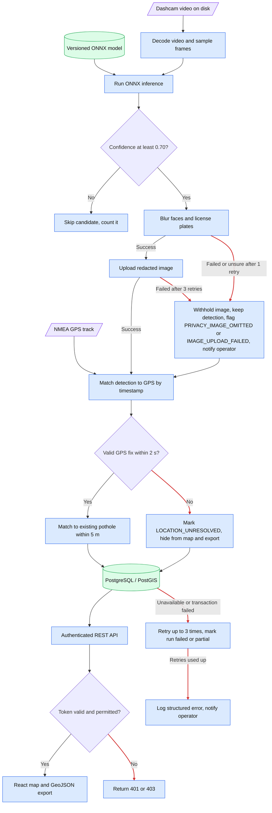
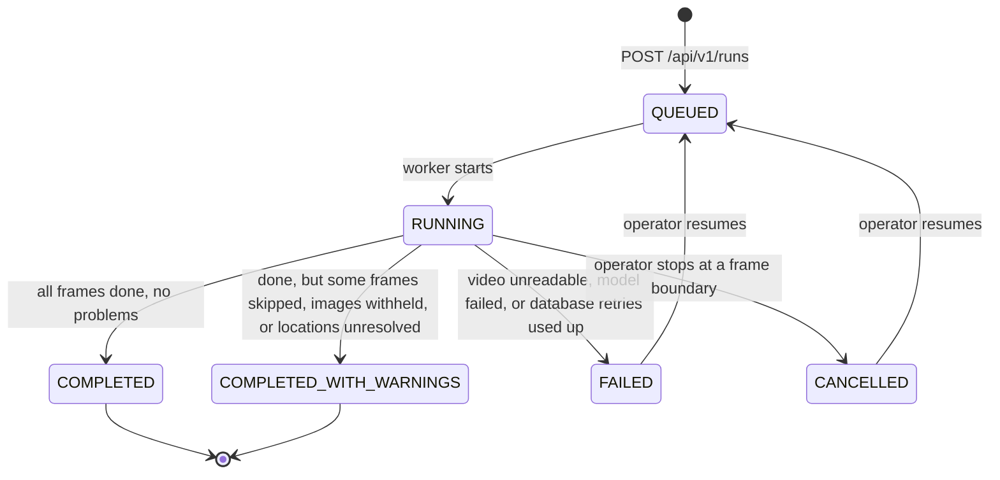
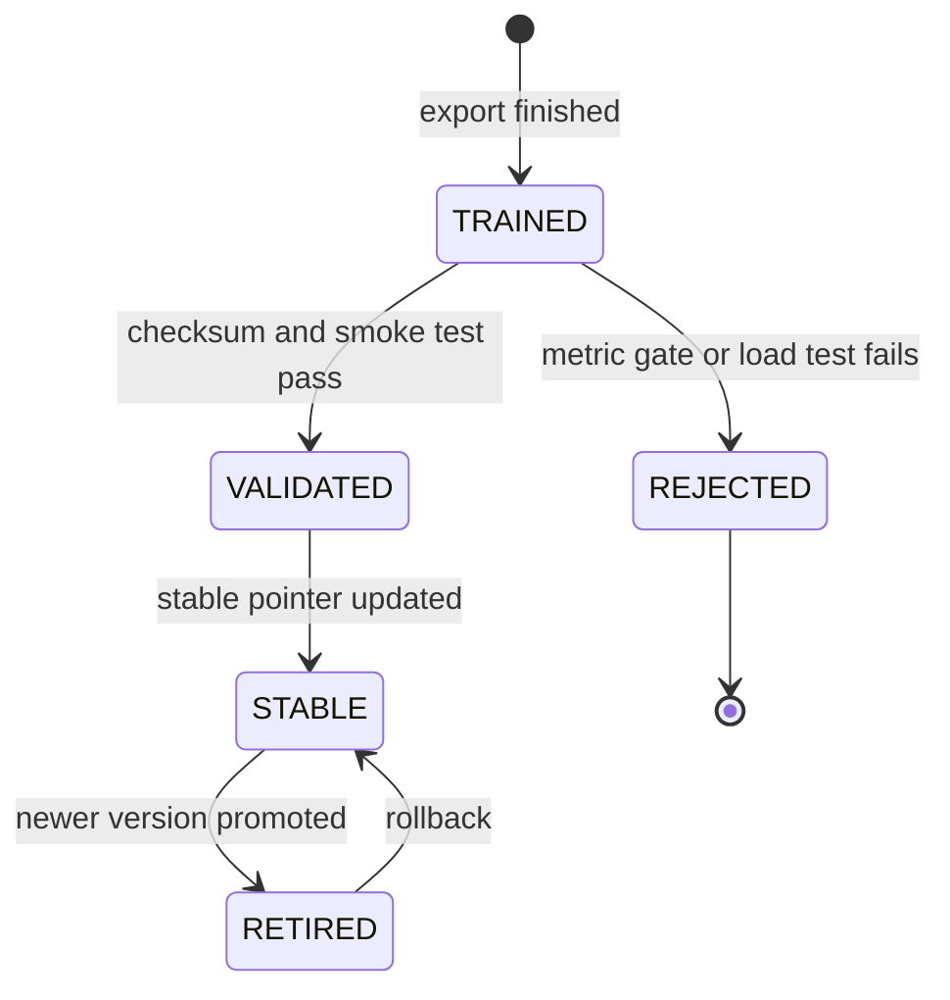

# StreetSmart: Detailed System Design (D2)

**Project:** StreetSmart: Automated Public Infrastructure Damage Detection and Geospatial Reporting System **Goal:** Analyze vehicle-mounted camera footage and synchronized GPS data to detect, geotag, and classify roadway damage; store validated records; and expose them through a municipal-facing map and standardized API. **Team Members:** Advait Vagerwal, Sahil Thakare, Raihan Rafeek **Course:** CS 5001 – Computer Science Senior Design **Advisor:** Eric Jamison **Assignment:** Assignment 7 – Detailed System Design, Part 2 (D2) **Document Version:** Draft 1.1 **Date:** October 13, 2026

---

# 1. Header, Conventions, and D2 Overview

## 1.1 Project goal

StreetSmart is a prototype tool for inspecting the quality of public roads. It works in batches on recorded dashcam video and matching GPS tracks. It:

1. Finds potholes in the video with an ONNX object-detection model,
2. Attaches GPS coordinates to each detection,
3. Blurs faces and license plates in the evidence photo _before_ the photo is saved anywhere,
4. Groups repeated sightings of the same pothole into one record, and
5. Shows the records on a web map and through a REST API.

The prototype supports municipal review and GIS export. It is not a production work-order system.

## 1.2 Diagram conventions

These conventions apply to every diagram in this document. Each figure repeats them in its caption.

|Notation|Meaning|
|---|---|
|Blue rectangle|A StreetSmart software component|
|Green cylinder|Saved data (database) or a versioned model file|
|Orange dashed rectangle|Something outside StreetSmart (device, third-party service)|
|Purple parallelogram|A file or data set entering or leaving the system|
|Solid arrow|A direct call or the main flow of data|
|Dashed arrow|A call to an outside service, or a batch/background flow|
|Diamond|A yes/no decision|
|**Red arrow**|An error or failure path|
|`PK` / `FK`|Primary key / foreign key (a table's unique ID / a link to another table)|
|`I1`–`I10`|Interface IDs from D0 (kept unless §2.14 says they changed)|
|`E-nn`|Edge-case ID from the register in §3|
|`FR-*` / `NFR-*`|Functional / non-functional requirement ID|

In the data-model diagram, boxes are tables, listed items are fields, and lines with crow's-foot ends show relationships ("one-to-many"). Locations use WGS84 (EPSG:4326). In GeoJSON, coordinates are written longitude first, then latitude.

## 1.3 Two-minute overview

**What the system is:** StreetSmart finds potholes in recorded driving video, works out where each one is using GPS data, and combines repeat sightings into one record per pothole. City staff can view those records on a map or pull them into their own GIS tools through an API.

**What D0 covered.** The overall architecture: Model Training, Trained Model Storage, Model Inference, the Ingestion Pipeline, the PostgreSQL/PostGIS database, the Backend API, and the Current Infrastructure Map. D0 also defined ten interfaces (I1–I10), the model-training flow, the video/GPS processing flow, and the main architecture decisions (the D0 decision log).

**What D1 covered.** The database design (`VIDEO_RUN`, `POTHOLE`, `DETECTION`, `EVIDENCE_IMAGE`), the weighted confidence formula, the 5 m rule for matching repeat sightings, the core API contracts, image-storage handling, and technology choices. D1 left Model Training, Trained Model Storage, Model Inference, and the Map for D2.

**What D2 adds.**

- A data model, behavior, and interface for every remaining component, plus the Ingestion Pipeline summary and the shared services (configuration, authentication, logging, notifications).
- Two lifecycle diagrams and one diagram that shows error paths (Figures 2.1–2.3).
- A review of the D0 interfaces, with the ones that were too complicated or exposed internal details revised (§2.14).
- A table of edge cases and how each is handled (§3).
- A table linking each requirement to the design elements that satisfy it, in both directions (§4). This becomes the Week 9 traceability matrix.
- Design rationale (§5) and a template for the peer review notes (§6).

## 1.4 Known gaps and open questions

|#|Gap or question|Decision made in this draft|Still open|Owner|
|---|---|---|---|---|
|1|What to do when blurring faces/plates fails or is uncertain|Retry once. If it still fails, **do not save the image**, but keep the detection and flag it `PRIVACY_IMAGE_OMITTED` (E-15).|Do municipal users need to be told an image was withheld? How well does the redaction model actually perform (needs test results)?|Raihan|
|2|Pothole status values and who may change them|The prototype only _shows_ the status already stored in `POTHOLE.status`. Changing status through the API is out of scope.|Final list of status values; whether status editing is added later.|Sahil|
|3|How video frames are matched to GPS points|Use the GPS fix nearest in time. If two fixes surround the detection and both are within 2 seconds, interpolate between them. Otherwise mark the location `LOCATION_UNRESOLVED` (E-17).|Is 2 seconds the right limit? Check against real drive data.|Raihan|
|4|Two workers creating the same pothole twice|Lock the geographic area before matching, and use a duplicate-check key `(run_id, frame_index, candidate_index)` (E-19, E-22).|Load-test with several workers at once.|Raihan|
|5|Secrets, data retention, backups, access control|Secrets come from environment variables or a secret store and are never committed to Git (§2.11).|Retention period, backup plan, who gets which role.|Sahil|
|6|Which identity provider issues login tokens|The design works with any provider that issues standard signed tokens (JWT). Roles: `viewer`, `exporter`, `operator` (§2.10).|Pick the actual provider and map its roles.|Raihan / Sahil|
|7|The exact User_Stories text|Requirements in §4 are reconstructed from D0/D1 references and acceptance criteria.|Compare §4 line by line with the real User_Stories and add anything missing.|All|
|8|Peer design review has not happened yet|§6 is a template.|Fill in from the real review, apply must-fix items, and mark changed rationale entries.|All|
|9|Exact D0 wording of interface I5|Treated here as "GPS track into the Ingestion Pipeline" (§2.14).|Confirm against D0.|Raihan|

## 1.5 Plain-language glossary

|Term|Meaning in this document|
|---|---|
|ONNX|A standard file format for trained AI models, so the model can run without the training software|
|YOLO|The family of object-detection models we train|
|PostGIS|A PostgreSQL add-on that understands maps (distances, areas, spatial search)|
|GeoJSON|A standard text format for map data that GIS tools can read|
|NMEA|The text format GPS devices record their position in|
|Confidence|A number from 0 to 1 showing how sure the model is that it saw a pothole|
|Bounded retry|Try again a fixed number of times (with short waits), then give up and report the failure|
|Duplicate-submission check|If the same detection is sent twice, the system recognizes it and counts it only once|
|Block by default|If we can't confirm a request or image is safe, we refuse it instead of letting it through|
|Bearer token|The login proof a client sends with each API request|
|Correlation ID|A unique ID attached to a request or run so all its log lines can be found together|
|Atomic|Happens completely or not at all; never half done|
|Spatial index (GiST)|A database index that makes "what is near here?" queries fast|
|Supabase|The external service that stores the redacted evidence images|

---

# 2. Finished Components: D2 Design

## 2.1 Figure 2.1: Main flow with error paths

**StreetSmart: Automated Public Infrastructure Damage Detection and Geospatial Reporting System** **Goal:** Convert vehicle video and GPS into privacy-redacted, geotagged pothole records that municipal users can inspect and export.



**Caption and conventions:** Blue = StreetSmart component; green = stored data or model; purple = input file; diamonds = decisions; red arrows = error paths. A skipped low-confidence candidate is normal, not an error. Failed redaction, failed upload, missing GPS, failed login, and a database outage each have a defined outcome. A `LOCATION_UNRESOLVED` record is never shown on the map or exported as if it had a real location. Related edge cases: E-10, E-15, E-17, E-20, E-24, E-32, E-33.

## 2.2 Figures 2.2 and 2.3: Lifecycle state machines

**Figure 2.2: Video run lifecycle** (`VIDEO_RUN.status`). Related: E-12, E-13, E-14, E-24.



**Figure 2.3: Model version lifecycle** (`ModelManifest.release_status`). Related: E-03, E-05, E-06, E-07.



**Caption and conventions (both figures):** Each box is a status; each arrow is the event that moves it to the next status. Only `STABLE` models are used by inference.

## 2.3 Component: Model Training

### Data model

No database. Training reads a labeled image data set and produces two files that stay together: the ONNX model and a manifest. The manifest holds model version, data set version, class labels, input size, training settings, validation scores, export time, and a checksum (a fingerprint used to detect corrupted files).

### Behavior

1. Load the data set manifest and check that each image has a matching annotation file.
2. Reject unreadable images, broken annotations, bounding boxes outside the image, and unknown class IDs. Log each rejected sample and why.
3. Stop before training if more than 5% of samples are invalid (D0 rule).
4. Train the YOLO-family detector using the settings committed to the repository.
5. Test on a held-out validation set and record precision, recall, and mAP (a standard detection-quality score).
6. If the scores meet the release threshold, export to ONNX and check that the exported model loads and has the expected input/output shape.
7. Write the files to a temporary location, calculate the checksum, then promote them as a new version in one atomic step.
8. If testing or export fails, keep the previous stable model and report the failure. A failed model never replaces the stable one.

### Interface

|Interface|Direction|Contents|
|---|---|---|
|I1|Data set → training|`dataset_version`, `classes[]`, `image_files[]`, `annotations[]` (YOLO format)|
|I2|Training → model storage|`ModelPackage { artifact, manifest }` (checksum is inside the manifest)|

### Errors

|Error condition|Error code|System response|Recoverable?|
|---|---|---|---|
|Too many invalid samples, or none valid|`DATASET_INVALID`|Write a validation report and stop training|After fix|
|Training diverges (scores blow up)|`TRAINING_DIVERGED`|Stop training; do not promote|After fix|
|Scores below release threshold|`METRIC_GATE_FAILED`|Do not promote; keep previous stable model|After fix|
|Export fails or exported model won't load|`EXPORT_FAILED`|Keep previous stable model|After fix|
|Disk full or no permission|`STORAGE_WRITE_FAILED`|Stop and report to operator|After fix|

**Primary owner:** Advait Vagerwal.

## 2.4 Component: Trained Model Storage

### Data model

Each model has a manifest with `model_version`, `artifact_path`, `checksum_sha256`, `input_name`, `input_shape`, `output_name`, `output_shape`, `class_labels`, `created_at`, `validation_metrics`, and `release_status` (see Figure 2.3). Promoted model files never change. A separate "stable pointer" says which version inference should use.

### Behavior

1. Accept a model only from the training/export workflow.
2. Check that the manifest is complete and that the checksum matches the file.
3. Save the file under a version-specific name. Never overwrite an existing version.
4. Move the stable pointer to the new version only after all checks pass.
5. Give the model's location and details to inference when it starts.
6. Keep the previous stable model until the new one passes load and smoke tests.
7. If a requested version is missing or damaged, refuse to start inference instead of quietly loading some other file.

### Interface

|Interface|Direction|Contents|
|---|---|---|
|I2|Training → storage|`ModelPackage` (see above)|
|I3|Storage → inference|`ResolveModel(version string) (ModelHandle, error)` where `ModelHandle { version, checksum, tensor_spec }`|

Inference must never start with a model that fails its integrity check.

### Errors

|Error condition|Error code|System response|Recoverable?|
|---|---|---|---|
|Model file missing|`MODEL_NOT_FOUND`|Refuse to load; report which version is missing|After fix|
|Checksum does not match|`MODEL_CHECKSUM_MISMATCH`|Refuse to load; notify operator (file may be corrupt)|After fix|
|Manifest incomplete or invalid|`MODEL_MANIFEST_INVALID`|Reject the manifest; report what is wrong|After fix|
|Storage unavailable|`MODEL_STORAGE_UNAVAILABLE`|Retry reads 3 times, then refuse to load|Yes, once storage returns|

**Primary owner:** Advait Vagerwal.

## 2.5 Component: Model Inference

### Data model

Inference keeps no saved data of its own. It reads the video from disk a piece at a time and holds only the current frame and its candidate detections in memory. Everything durable goes into `VIDEO_RUN`, `DETECTION`, `POTHOLE`, and `EVIDENCE_IMAGE`.

### Behavior

1. Get the model with `ResolveModel` and verify its checksum and input/output shape before processing.
2. Open the video and decode frames one at a time. Never load the whole video into memory.
3. Pick frames to analyze using the configured sampling rate (set in configuration, §2.11).
4. Resize and normalize each chosen frame to the size the model expects.
5. Run ONNX Runtime from the Go pipeline.
6. Turn the model output into candidate boxes with a class and confidence.
7. Discard malformed boxes and anything below `0.70` confidence.
8. For each accepted candidate: crop an evidence image with the box drawn on it, blur faces and plates, then hand it to the upload step (Figure 2.1).
9. Emit a detection event only after the image step has finished with either a valid image or an allowed "image withheld" result.
10. Skip a bad frame and keep going. Mark the run failed only if the video can no longer be decoded or the model/runtime fails.
11. Set the run status to `COMPLETED`, `COMPLETED_WITH_WARNINGS`, or `FAILED` (Figure 2.2).

### Interface

|Interface|Direction|Contents|
|---|---|---|
|I3|Storage → inference|`ModelHandle`|
|I4|Caller → inference|`ProcessVideo(ctx, job InferenceJob) (RunSummary, error)` where `InferenceJob { run_id, video_ref }`. Sampling settings come from configuration, not from the caller.|
|I6|Inference → ingestion|`DetectionEvent { run_id, frame_index, candidate_index, detected_at, damage_type, model_confidence, bbox{x_min,y_min,x_max,y_max}, image_ref? }`|

**Performance target:** process 60 minutes of footage within 1,200 seconds (AC-01.1). This is a target to test on the agreed hardware, not a measured result.

### Errors

|Error condition|Error code|System response|Recoverable?|
|---|---|---|---|
|One frame is corrupt|`FRAME_CORRUPT`|Skip the frame, add to the warning count|Yes|
|Video missing, unsupported, or too damaged to read|`VIDEO_UNREADABLE`|Mark run `FAILED`|After fix|
|Model fails to load or run|`MODEL_LOAD_FAILED` / `INFERENCE_FAILED`|Stop the run, log a critical error, notify operator|After fix|
|Sending a detection fails briefly|`SUBMIT_TRANSIENT`|Retry up to 3 times; the duplicate-submission check keeps counts correct|Yes|
|Sending still fails after retries|`SUBMIT_EXHAUSTED`|Mark run `FAILED` (or partial) and keep enough state to resume|After fix|

**Primary owner:** Raihan Rafeek.

## 2.6 Component: Ingestion Pipeline

(D1 covered the matching and confidence rules. This section gives the D2 view of its data, behavior, and errors.)

### Data model

No data of its own. It validates detections, finds their GPS location, and passes them to the database as one `DetectionRecord` (fields as in D1: run, frame, candidate, time, confidence, location or `LOCATION_UNRESOLVED`, optional evidence image reference).

### Behavior

1. Receive a `DetectionEvent` (I6) and the parsed GPS fixes for the run (I5).
2. Validate confidence (0 to 1), coordinates, and timestamp.
3. Find the location: nearest GPS fix in time, or interpolate between two fixes within 2 seconds. If none qualifies, set `LOCATION_UNRESOLVED` and log within 3 seconds (AC-01.2).
4. Pass the record to the database (I7), which matches it to an existing pothole within 5 m or creates a new one.
5. Insert an evidence-image row only if the redacted image uploaded successfully.

### Interface

|Interface|Direction|Contents|
|---|---|---|
|I5|GPS → ingestion|List of `GpsFix { time, lat, lon }` parsed once from the NMEA file|
|I6|Inference → ingestion|`DetectionEvent`|
|I7|Ingestion → database|`RecordDetection(rec DetectionRecord) (RecordResult, error)`|

### Errors

|Error condition|Error code|System response|Recoverable?|
|---|---|---|---|
|Confidence or coordinates out of range|`DETECTION_INVALID`|Reject with `422`|After fix|
|No GPS fix close enough in time|`LOCATION_UNRESOLVED`|Save record flagged; hide from map and export; log|Partial|
|Same detection sent twice|`DUPLICATE_SUBMISSION`|Return original result; do not count twice|Yes|
|Image upload fails|`IMAGE_UPLOAD_FAILED`|Retry 3 times, then save detection without image|Partial|

**Primary owner:** Raihan Rafeek.

## 2.7 Component: Current Infrastructure Map

### Data model

No saved data. The browser keeps: current map area (bounding box), filters, current results, selected pothole ID, loading/error state, and result limit. Login credentials follow the identity provider's rules and are never written to logs.

### Behavior

1. Load the map and set the starting view.
2. Ask the API for potholes in the visible area, with optional confidence and status filters.
3. Draw the returned GeoJSON as markers or clusters.
4. When the map moves or filters change, wait briefly (debounce) before asking again, and ignore any answer that arrives after a newer request.
5. When a marker is selected, show that pothole's details and its redacted evidence images.
6. Show clear states for: loading, no results, partial data, not signed in, and service unavailable.
7. Never show `LOCATION_UNRESOLVED` records as map markers.
8. Make controls usable by keyboard with accessible labels. Never use color alone to show severity or status.

### Interface

|Interface|Request|Response|
|---|---|---|
|I9|`GET /api/v1/potholes?bbox=min_lon,min_lat,max_lon,max_lat&min_confidence=0.70&status=ALL&limit=100`|GeoJSON FeatureCollection (RFC 7946)|
|I9 (details)|`GET /api/v1/potholes/{id}`|Pothole detail object|

### Errors (what the user sees)

|Error condition|HTTP status|Map response|Recoverable?|
|---|---|---|---|
|Invalid filters|`400`|Explain which filter is invalid|Yes|
|Not signed in or session expired|`401`|Prompt sign-in|Yes|
|Signed in without permission|`403`|Show "insufficient permission"|After fix (role change)|
|Selected pothole no longer exists|`404`|Say the record was removed; refresh|Yes|
|Too many requests|`429`|Back off, then retry|Yes|
|Service unavailable or no network|`503` / network error|Keep old map data, show a stale-data warning, offer Retry|Yes|
|Malformed GeoJSON|(response body invalid)|Keep last valid display, show a data error|After fix|

**Primary owner:** Sahil Thakare.

## 2.8 Component: PostgreSQL/PostGIS Database

### Data model

D1 defines four tables: `VIDEO_RUN`, `POTHOLE`, `DETECTION`, and `EVIDENCE_IMAGE`. D2 keeps that design. Rules the database enforces:

- Every `DETECTION.video_run_id` points to an existing `VIDEO_RUN`.
- Every matched `DETECTION.pothole_id` points to one `POTHOLE`.
- Every `EVIDENCE_IMAGE.detection_id` points to a `DETECTION`.
- `model_confidence` and `aggregated_confidence` are between 0 and 1.
- Frame indexes are zero or higher; timestamps include a time zone.
- Locations are valid EPSG:4326 points.
- An evidence-image row is added only after the redacted image upload succeeded.
- **Duplicate check (decided in D2):** a unique constraint on `(video_run_id, frame_index, candidate_index)`. One frame can contain several potholes, so `candidate_index` numbers them within the frame.

### Behavior

1. Accept validated records from the ingestion service.
2. In one transaction, find a matching pothole, insert the detection, and update the pothole's confidence and count.
3. **Concurrency (decided in D2):** before matching, take a lock on the geographic grid cell (and neighboring cells, always in the same order to avoid deadlock) so two workers cannot both create a pothole for the same spot.
4. Commit only if all the rules above hold.
5. Serve map-area and detail queries to the API using parameterized statements (user input is never pasted into SQL text).
6. Return errors to the caller. Never silently drop a record.

### Interface

|Interface|Direction|Contents|
|---|---|---|
|I7|Ingestion → database|`RecordDetection(DetectionRecord) (RecordResult, error)`|
|I8|Database → API|`FindPotholes(bbox, filters, limit) ([]PotholeSummary, error)` and `GetPothole(id) (PotholeDetail, error)`. No raw table rows are returned.|

### Errors

|Error condition|Error code|System response|Recoverable?|
|---|---|---|---|
|Rule violated (foreign key, unique, check)|`CONSTRAINT_VIOLATION`|Roll back; return a safe validation or conflict error|After fix|
|Brief conflict or deadlock|`TX_CONFLICT`|Retry the whole transaction with short random waits|Yes|
|Connection unavailable|`DB_UNAVAILABLE`|Retry within a time limit, then return `503`|Yes, once DB returns|
|Query too slow|`QUERY_TIMEOUT`|Cancel the query; return `503`|Yes|
|Retries used up|`DB_RETRIES_EXHAUSTED`|Keep run failure status; send operational event|After fix|

**Primary owner:** Raihan Rafeek.

## 2.9 Component: Backend API

### Data model

The API sends and receives purpose-built request/response shapes, never raw database rows: `CreateRunRequest/Response`, `CreateDetectionRequest/Response`, `PotholeFeature`, `PotholeDetail`, and `ProblemDetails` (the error format). Responses never include database connection details, stack traces, secrets, or unresolved coordinates.

### Behavior

1. Enforce request-size and content-type limits.
2. Check the login token and the caller's permission (§2.10).
3. Validate path parameters, query parameters, coordinate ranges, confidence values, and timestamps.
4. Use parameterized SQL and a limited-size connection pool.
5. Return map data as GeoJSON with coordinates as `[longitude, latitude]`.
6. Return every error in the same format, with an HTTP status and a request ID.
7. Apply timeouts and rate limits.
8. Log request details and results, but never tokens, secrets, or raw image content.

### Interface

|Method and path|Purpose|Success|Required permission|
|---|---|---|---|
|`POST /api/v1/runs`|Register a video run|`201 Created` with `run_id`, status `QUEUED`|`operator`|
|`POST /api/v1/detections`|Submit one detection|`201 Created` the first time; `200 OK` with the original result if repeated|`operator`|
|`GET /api/v1/potholes`|Pothole query for the map|`200 OK` GeoJSON|`viewer`|
|`GET /api/v1/potholes/{id}`|Pothole details|`200 OK` detail object|`viewer`|
|`GET /api/v1/export/geojson`|Export for city GIS systems|`200 OK` GeoJSON plus export metadata|`exporter`|

**Decision (export endpoint):** keep a dedicated `GET /api/v1/export/geojson`. It follows the same bounding-box and limit rules as the map query (maximum 500). The map query defaults to 100 results. This gives city systems a stable contract that does not change when the map's needs change.

**Interface I10:** authenticated HTTPS request with a validated bounding box and output format; returns RFC 7946 GeoJSON plus export metadata. City systems never connect to PostgreSQL directly.

### Errors

|HTTP status|Error code|When|System response|Recoverable?|
|---|---|---|---|---|
|`400`|`INVALID_PARAMETER`|Bad bounding box, limit, UUID, or malformed JSON|Return problem response with field details; no database change|After fix|
|`401`|`UNAUTHENTICATED`|Missing, expired, or invalid token|Return problem response; no handler runs|After fix|
|`403`|`FORBIDDEN`|Valid token, missing permission|Return problem response|After fix|
|`404`|`NOT_FOUND`|Run or pothole does not exist|Return problem response|After fix|
|`409`|`CONFLICT`|Same duplicate key with different content|Return problem response; do not change data|After fix|
|`422`|`DETECTION_INVALID`|Values out of range (e.g., confidence 1.4)|Return problem response|After fix|
|`429`|`RATE_LIMITED`|Too many requests|Ask client to wait and retry|Yes|
|`500`|`INTERNAL_ERROR`|Unexpected failure|Generic message and request ID; details only in logs|Varies|
|`503`|`DEPENDENCY_UNAVAILABLE`|Database or login provider unavailable|Generic message; log details|Yes, once restored|

Example error body:

```json
{
  "type": "https://streetsmart.example/errors/invalid-parameter",
  "title": "Invalid request parameter",
  "status": 400,
  "detail": "One or more request parameters are outside the allowed range.",
  "instance": "/api/v1/potholes",
  "request_id": "generated-correlation-id"
}
```

The domain `streetsmart.example` is a placeholder until the team picks a real API domain. Responses never contain stack traces or SQL.

**Primary owner:** Raihan Rafeek.

## 2.10 Shared component: Authentication and authorization

### Data model

StreetSmart has no user table of its own and stores no passwords. The API checks a bearer token from an identity provider (not yet chosen, see §1.4 #6) and turns the token's claims into permissions. Roles:

|Role|Allowed|
|---|---|
|`viewer`|Read the map and pothole details|
|`exporter`|Everything `viewer` can do, plus GeoJSON export|
|`operator`|Register runs and submit detections (used by the processing workers)|

### Behavior

1. Require HTTPS.
2. Check the token's signature, issuer, audience, expiry, and required claims.
3. Allow only what the role permits (least privilege).
4. Missing, invalid, or expired token → `401`. Valid token without permission → `403`.
5. Never log tokens or secrets.
6. **Block by default:** if the token cannot be checked (for example the provider is down and no valid cached keys exist), refuse the request. Never skip authentication.
7. Check a token once at the start of a request; a request already in progress is not cut off if the token expires mid-way.

### Interface

`AuthenticateAndAuthorize(requiredPermission string) gin.HandlerFunc` (middleware that wraps each protected route).

### Errors

|Error condition|Error code|System response|Recoverable?|
|---|---|---|---|
|Missing or invalid token|`UNAUTHENTICATED` (`401`)|Reject; no handler runs|After fix|
|Expired token|`UNAUTHENTICATED` (`401`)|Reject; client signs in again|Yes|
|Not enough permission|`FORBIDDEN` (`403`)|Reject|After fix|
|Cannot verify token (provider or keys unavailable)|`AUTH_PROVIDER_UNAVAILABLE` (`503`)|Reject and alert; use cached keys only while still valid|Yes, once provider returns|

**Owner:** Raihan Rafeek (API integration). Account and role ownership still to be assigned.

## 2.11 Shared component: Configuration and secrets

### Data model

No saved data. Settings come from environment variables or a secret store, such as: database URL, storage endpoint and bucket, model version, confidence threshold (`0.70`), match radius (`5.0 m`), maximum GPS gap (`2 s`), frame sampling rate, API timeouts, retry count, and log level. Credentials are never committed to Git.

### Behavior

1. Load settings at startup.
2. Check that required values exist, numbers are in range, and related settings agree.
3. Stop startup if a required secret is missing or a critical setting is invalid.
4. Use a default only for settings explicitly marked optional.
5. Log setting _names_ and problems, never secret _values_.
6. Freeze settings for the duration of a run (a changed value applies to the next run).

### Interface

`LoadConfig() (Config, error)` and `ValidateConfig(Config) error`.

### Errors

|Error condition|Error code|System response|Recoverable?|
|---|---|---|---|
|Required setting missing|`CONFIG_MISSING`|Stop startup; name the setting|After fix|
|Value out of range|`CONFIG_INVALID`|Stop startup; name the setting and valid range|After fix|
|Optional setting missing|(none)|Use the documented default|Yes|
|Secret store unavailable|`SECRET_STORE_UNAVAILABLE`|Retry startup a few times, then stop|Yes, once store returns|

**Owner:** shared. Raihan: API and inference settings; Sahil: deployment settings; Advait: training settings.

## 2.12 Shared component: Structured logging and correlation

### Data model

No saved data model. Each log entry has: timestamp, severity, component, event name, run ID (if any), correlation ID, error code, and a short cleaned message.

### Behavior

1. Create or pass along a correlation ID for each API request and each video run.
2. Log startup/shutdown, run status changes, retries, validation failures, redaction failures, API errors, and outside-service failures.
3. Remove credentials, tokens, secrets, and raw image data before writing.
4. Do not log full GPS trails or identifiable image data.
5. Keep per-frame messages at debug level, or log counts instead, so logs don't flood.
6. If the log destination fails, write to standard error and keep processing when safe. A logging failure must never cause a privacy check to be skipped.

### Interface

`LogEvent(level, component, event string, fields map[string]any)`

### Errors

|Error condition|Error code|System response|Recoverable?|
|---|---|---|---|
|Log destination unavailable|`LOG_SINK_UNAVAILABLE`|Write to standard error and continue|Yes (less detail kept)|
|Unsafe or malformed fields|`LOG_FIELD_REJECTED`|Drop the unsafe fields and log a cleaned warning|Yes|

**Owner:** shared; each component owner adds logging to their component.

## 2.13 Shared component: Operational notifications

### Data model

No saved business data. A notification contains `event_id`, `severity`, `component`, `run_id` or `request_id`, `error_code`, `summary`, `occurred_at`, and retry count. It never contains secrets, raw frames, or unredacted images.

### Behavior

1. Notify on: model-load failure, failed runs, repeated database or storage failures, and redaction failures.
2. Combine repeats: only one notification per `(component, error_code, run_id)` within a set time window.
3. If delivery fails, retry a few times.
4. If the notification service is down, keep the event in the logs and in the run status. A failed notification never hides the original error.
5. Email or chat delivery is optional until a provider is chosen. Logs plus visible run status are the minimum for the prototype.

### Interface

`Notify(ctx context.Context, event OperationalEvent) error`

### Errors

|Error condition|Error code|System response|Recoverable?|
|---|---|---|---|
|Provider times out|`NOTIFY_TIMEOUT`|Retry a few times|Yes|
|Provider unavailable|`NOTIFY_PROVIDER_UNAVAILABLE`|Log it and mark delivery failed|Yes (alert delayed)|
|Event missing required fields|`NOTIFY_EVENT_INVALID`|Reject and log a cleaned error|After fix|

**Owner:** shared; the person responsible for deployment/provider is to be assigned.

## 2.14 Interface review: D0 interfaces revisited

D0 interfaces I1–I10 were checked for two problems: **too many parameters**, and **leaking internal details** (file paths, database rows, storage names). The D0 interface IDs are unchanged; only their contents were revised.

|Interface|Connects|Problem found|Revision|Status|
|---|---|---|---|---|
|I1|Data set → training|None (4 inputs, all needed)|None|Kept|
|I2|Training → model storage|Checksum sent separately but already in the manifest|`ModelPackage { artifact, manifest }`|Revised|
|I3|Model storage → inference|Exposed a file path and raw tensor details|Return `ModelHandle { version, checksum, tensor_spec }` via `ResolveModel`|Revised|
|I4|Caller → inference|Four parameters (video path, run ID, sampling settings, timestamps); exposed disk layout|`InferenceJob { run_id, video_ref }`. Sampling comes from configuration; timestamps come from the video itself.|Revised|
|I5|GPS → ingestion|Raw NMEA text would leak into the synchronizer (wording to confirm against D0)|Parse once into a list of `GpsFix { time, lat, lon }`|Revised|
|I6|Inference → ingestion|`image_path` exposed storage details; no way to separate several detections in one frame|Use opaque `image_ref`; add `candidate_index`|Revised|
|I7|Ingestion → database|Many loose fields|Single `DetectionRecord` passed to `RecordDetection`|Revised|
|I8|Database → API|"Query result rows" exposed table structure|Return `PotholeSummary` / `PotholeDetail`|Revised|
|I9|API → map|None (bounding box and filters only)|Documented defaults (`limit=100`, `min_confidence=0.70`)|Kept|
|I10|API → city systems|Dedicated vs shared endpoint was undecided|Dedicated `GET /api/v1/export/geojson` (§2.9)|Decided|

---

# 3. Edge Cases and Error Handling

All four categories (boundary values, timing and concurrency, bad or missing input, external dependencies) are covered for every component. **Behavior** is one of: Retry, Degrade (keep going with reduced output), Fall back, or Surface error. **Recoverable?** means: _Yes_ = the system continues on its own with no data loss; _Partial_ = it continues but some output is withheld or reduced; _After fix_ = a person must correct the input, configuration, or dependency first (no data lost).

|ID|Component|Category|Edge case|Behavior and decision|Handler|Recoverable?|
|---|---|---|---|---|---|---|
|E-01|Model Training|Boundary values|Data set has zero valid image/annotation pairs|**Surface error:** stop before training and write a validation report|`DatasetValidator`|After fix|
|E-02|Model Training|Boundary values|More than 5% of samples are invalid|**Surface error:** stop training (D0 rule); nothing is promoted|`DatasetValidator`|After fix|
|E-03|Model Training|Timing/concurrency|Two training jobs try to promote a model at once|**Retry:** a version lock lets one win; the other re-checks against the new stable version and retries once|`ArtifactPromoter`|Yes|
|E-04|Model Training|Bad/missing input|Annotation file missing, corrupt, or box outside the image|**Degrade:** skip the sample and log file and reason; stop only if invalid samples pass 5%|`DatasetValidator`|Yes|
|E-05|Model Training|External dependency|Training process or disk fails during export|**Fall back:** write to a temporary path and promote only after checksum and smoke test pass; previous stable model stays active|`ArtifactPromoter`|Yes|
|E-06|Trained Model Storage|Boundary values|Empty model file or incomplete manifest|**Surface error:** reject and leave the stable pointer unchanged|`ModelArtifactValidator`|After fix|
|E-07|Trained Model Storage|Timing/concurrency|Inference asks for the model while a new version is being promoted|**Fall back:** a running session keeps the version it already loaded; new sessions read the updated pointer|`ModelResolver`|Yes|
|E-08|Trained Model Storage|Bad/missing input|Requested model version does not exist|**Surface error:** `MODEL_NOT_FOUND`; inference won't start and never guesses a version|`ModelResolver`|After fix|
|E-09|Trained Model Storage|External dependency|Storage unavailable, or file changed after promotion (checksum mismatch)|**Retry** reads 3 times for an outage. **Surface error** and notify for a checksum mismatch (never retried; file is refused)|`ModelResolver`, `OperationalNotifier`|Yes (outage); After fix (corruption)|
|E-10|Model Inference|Boundary values|Confidence is exactly `0.70`|**Degrade rule:** accept `>= 0.70`; skip anything lower|`DetectionFilter`|Yes|
|E-11|Model Inference|Boundary values|Box has zero area, negative size, or lies outside the frame|**Degrade:** discard the candidate and add to the invalid-output count|`OutputValidator`|Yes|
|E-12|Model Inference|Timing/concurrency|Run is cancelled or worker shuts down mid-video|**Degrade:** stop at a frame boundary, save state (`CANCELLED` or `FAILED`), allow resume; the duplicate check prevents double counting|`RunController`|Yes|
|E-13|Model Inference|Bad/missing input|Video is unsupported, corrupt, or missing|**Surface error:** `VIDEO_UNREADABLE`; run is `FAILED`, never shown as success|`VideoDecoder`|After fix|
|E-14|Model Inference|External dependency|ONNX Runtime or model initialization fails|**Surface error:** don't start, log a critical event, notify operator; never fall back to an unchecked model|`InferenceInitializer`|After fix|
|E-15|Model Inference (privacy filter)|Bad/missing input|Redaction returns invalid output or can't tell whether faces/plates were removed|**Retry** once; then **Degrade:** do not save the image, keep the detection flagged `PRIVACY_IMAGE_OMITTED`, notify operator|`PrivacyFilter`|Partial|
|E-16|Ingestion Pipeline|Boundary values|Confidence outside 0–1, or coordinates outside valid ranges|**Surface error:** reject with `422`|`DetectionValidator`|After fix|
|E-17|Ingestion Pipeline|Timing/concurrency|GPS fix missing, or nearest fix is more than 2 s from the detection|**Degrade:** mark `LOCATION_UNRESOLVED`, log within 3 s (AC-01.2), keep out of map and export|`GpsSynchronizer`|Partial|
|E-18|Ingestion Pipeline|Timing/concurrency|Two workers find the same new pothole at the same time|**Retry:** area lock plus re-check inside the transaction; on a conflict, re-match once, then surface a conflict|`PotholeMatcher`|Yes|
|E-19|Ingestion Pipeline|Bad/missing input|Same `(run_id, frame_index, candidate_index)` sent twice|**Fall back:** return the original result with `200`; never count twice. Same key with different content returns `409`|`DuplicateSubmissionGuard`|Yes|
|E-20|Ingestion Pipeline|External dependency|Supabase image upload fails|**Retry** 3 times; then **Degrade:** save the detection without an image, flagged `IMAGE_UPLOAD_FAILED`; no image row is created|`EvidenceImageUploader`|Partial|
|E-21|PostgreSQL/PostGIS|Boundary values|A detection is exactly 5.0 m from an existing pothole, or two potholes are both in range|**Degrade rule:** 5.0 m counts as a match (inclusive); with two candidates choose the nearest; if they are within 0.1 m of each other, flag `AMBIGUOUS_MATCH` and do not merge|`SpatialMatchQuery`|Yes|
|E-22|PostgreSQL/PostGIS|Timing/concurrency|Transaction conflict or deadlock during concurrent ingestion|**Retry** the whole transaction up to 3 times with short random waits; then return a service error and keep run status|`TransactionRunner`|Yes|
|E-23|PostgreSQL/PostGIS|Bad/missing input|Foreign key, unique, or check rule fails|**Surface error:** roll back and map the rule name to a safe conflict or validation response|`RepositoryErrorMapper`|After fix|
|E-24|PostgreSQL/PostGIS|External dependency|Database unavailable or query times out|**Retry** the connection within a deadline, then return `503`; record failed or partial run status|`DatabasePool`, `RunController`|Yes|
|E-25|Backend API|Boundary values|Bounding box out of range, min greater than max, NaN/Infinity, or crossing the 180° line|**Surface error:** reject before querying the database with a `400` problem response within AC-02.2's 1 s (the prototype does not support boxes crossing the 180° line)|`SpatialQueryValidator`|After fix|
|E-26|Backend API|Boundary values|`limit` is 0, negative, or above 500|**Surface error:** reject with `400`; if omitted, use the default (100)|`RequestValidator`|After fix|
|E-27|Backend API|Timing/concurrency|Client repeats a POST after a timeout and can't tell if the first one worked|**Fall back:** the duplicate check returns the original result; no double counting|`DuplicateSubmissionGuard`|Yes|
|E-28|Backend API|Bad/missing input|Malformed JSON, invalid UUID, or missing required field|**Surface error:** `400` with field-level details and request ID; no database change|`RequestBinder`|After fix|
|E-29|Backend API|External dependency|Connection pool full or database unreachable|**Surface error:** `503` with a generic message; log sanitized details; no SQL or stack trace in the response|`DatabaseErrorHandler`|Yes|
|E-30|Authentication|Boundary values|Token expires at the exact moment it is checked|**Surface error:** treat as expired, return `401`; client signs in again|`TokenValidator`|Yes|
|E-31|Authentication|Timing/concurrency|Token expires while a long export is already running|**Fall back:** the token is checked once at request start; the running request finishes; the next request needs a fresh token|`AuthMiddleware`|Yes|
|E-32|Authentication|Bad/missing input|Missing, malformed, or invalid bearer token|**Surface error:** `401`; no protected handler runs|`AuthMiddleware`|After fix|
|E-33|Authentication|External dependency|Identity provider or its signing keys unavailable|**Fall back:** use cached keys only while still valid; otherwise block by default with `503` and alert|`TokenKeyCache`, `AuthMiddleware`|Yes|
|E-34|Current Infrastructure Map|Boundary values|Visible area has no potholes|**Degrade:** show a clear "no results" message, not an error|`MapQueryState`|Yes|
|E-35|Current Infrastructure Map|Timing/concurrency|An older response arrives after a newer request|**Fall back:** ignore it using a request sequence number|`ViewportRequestController`|Yes|
|E-36|Current Infrastructure Map|Bad/missing input|API returns malformed GeoJSON or missing location|**Fall back:** keep the last valid display and show a data error|`GeoJSONValidator`|After fix|
|E-37|Current Infrastructure Map|External dependency|API or network is unavailable|**Fall back:** keep the last good data with a stale-data warning and a Retry button; never imply it is current|`ApiClient`|Yes|
|E-38|Configuration|Boundary values|Threshold, radius, or timeout outside the allowed range|**Surface error:** stop startup naming the setting and valid range; never quietly adjust it|`ConfigValidator`|After fix|
|E-39|Configuration|Timing/concurrency|Settings change while a run is active|**Fall back:** the run keeps a frozen copy of its settings; new values apply to new runs|`ConfigSnapshot`|Yes|
|E-40|Configuration|Bad/missing input|Required database, model, or storage setting missing|**Surface error:** stop startup and name the missing setting without printing secrets|`ConfigLoader`|After fix|
|E-41|Configuration|External dependency|Secret store unavailable|**Retry** startup a few times, then **Surface error** and stop; no built-in fallback secret|`SecretProvider`|Yes|
|E-42|Logging|Boundary values|Per-frame logging grows too large|**Degrade:** log counts for routine frames; keep every warning and error|`LogSampler`|Yes|
|E-43|Logging|Timing/concurrency|Many workers write logs at the same time|**Fall back:** a thread-safe writer; every entry carries run and request IDs|`StructuredLogger`|Yes|
|E-44|Logging|Bad/missing input|Log fields contain tokens, secrets, or raw image data|**Degrade:** strip sensitive fields before writing|`LogSanitizer`|Yes|
|E-45|Logging|External dependency|Log destination unavailable|**Fall back:** write sanitized events to standard error and continue; privacy failures still block image saving|`LogFallback`|Yes (less detail kept)|
|E-46|Notifications|Boundary values|Many identical critical events in a short time|**Degrade:** combine into one summary notification|`NotificationDeduplicator`|Yes|
|E-47|Notifications|Timing/concurrency|Several workers send the same alert at once|**Fall back:** a stable event key suppresses duplicates where possible|`NotificationDeduplicator`|Yes|
|E-48|Notifications|Bad/missing input|Event lacks severity, component, or error code|**Surface error:** reject and log a cleaned error; the original failure stays visible in logs and run status|`NotificationValidator`|After fix|
|E-49|Notifications|External dependency|Email/chat provider times out or is unavailable|**Retry** a few times; then **Degrade:** record the delivery failure and keep the event in logs and run status|`NotificationDispatcher`|Yes (alert delayed)|

---

# 4. Requirements Traceability Table

## 4.1 Requirements to design elements (forward check)

Requirement wording is reconstructed from D0/D1 references and acceptance criteria and must be compared with the real User_Stories (see §1.4 #7). Priorities are proposed (Must / Should). Figures: 2.1 main flow with error paths, 2.2 run lifecycle, 2.3 model lifecycle.

|ID|Requirement (short text)|Priority|Specific design elements|How it is satisfied, gaps, and edge cases|
|---|---|---|---|---|
|US-01|Detect and display geotagged roadway damage from drive footage|Must|`ProcessVideo` (§2.5); `DETECTION` / `POTHOLE` tables (D1); I4, I6, I7; Figs. 2.1, 2.2|Inference finds candidates; ingestion adds GPS locations and saves records; the map reads them as GeoJSON. Edge cases: E-13, E-17. No gap.|
|US-02|Combine repeat sightings into one pothole record with a confidence score|Must|D1 weighted confidence (§3.1); D1 spatial matching (§3.2); `POTHOLE.observation_count`; database transaction and area lock (§2.8)|Weighted score and 5 m matching merge repeat sightings; near-equal ambiguous matches are flagged, not merged. Edge cases: E-18, E-19, E-21, E-22. No gap.|
|US-03|Let municipal staff review pothole records and status|Should|`POTHOLE.status` (D1); Map (§2.7); `GET /api/v1/potholes/{id}`|Map and detail views show status and evidence images. **Gap:** status values and who may change them are not defined, so status editing is out of scope for the prototype (§1.4 #2). No edge case is specific to this requirement.|
|US-04|Blur faces and license plates before images are saved or shown|Must|`PrivacyFilter` step (§2.5); Fig. 2.1; `EVIDENCE_IMAGE.storage_path`; image-row rule (§2.8)|Blurring happens before upload; a failed or uncertain result means no image is saved (detection kept). Edge cases: E-15, E-20. **Gap:** redaction coverage still needs test results (§1.4 #1).|
|US-05|Provide standard geospatial records for city GIS tools|Should|I10; `GET /api/v1/export/geojson` (§2.9); D1 GeoJSON contract|Authenticated HTTPS endpoint returns RFC 7946 GeoJSON; unresolved locations are excluded. Edge cases: E-25, E-26. No gap.|
|AC-01.1|Process 60 min of video within 1,200 s, applying detection and matching rules|Must|D0 timing budget; §2.5; D1 confidence and matching algorithms; Fig. 2.1|Batch design and the `>= 0.70` threshold are defined. **Gap:** speed is unproven until benchmarked on the target hardware. Edge cases: E-10 to E-14.|
|AC-01.2|Isolate GPS problems, flag the location as unresolved, log within 3 s|Must|`LOCATION_UNRESOLVED` rule (D1); `GpsSynchronizer` (§2.6); Fig. 2.1|Missing or distant GPS fixes never produce a real location on the map or export. Edge case: E-17. **Gap:** the 2 s maximum gap is a proposed value to validate.|
|AC-02.1|Export up to 500 potholes within 5 s|Must|`GET /api/v1/potholes` and `/export/geojson` (§2.9); spatial index (D1 §2.4); limit cap of 500|Limit and spatial index support the target. **Gap:** needs a benchmark. Edge cases: E-24, E-26.|
|AC-02.2|Reject invalid spatial parameters within 1 s|Must|`SpatialQueryValidator` (§2.9); `ProblemDetails` error format; I10|Checks are done before touching the database. Edge case: E-25. **Gap:** latency needs testing.|
|NFR-SEC-01|Protect the API and city exports with authentication and authorization|Must|`AuthenticateAndAuthorize` (§2.10); roles `viewer` / `exporter` / `operator`; `401` / `403` rules|Token checks and least-privilege roles on every protected route. Edge cases: E-30 to E-33. **Gap:** identity provider not yet chosen (§1.4 #6).|
|NFR-PRIV-01|Never save or show unredacted evidence images|Must|`PrivacyFilter` (§2.5); image-row rule (§2.8); log sanitizer (§2.12)|Blur first, upload second; block by default when unsure. Edge cases: E-15, E-20, E-44. No gap beyond US-04's test-results gap.|
|NFR-PERF-01|Keep map queries responsive|Should|Spatial index (D1); API timeout and connection pool (§2.9); request sequence controller (§2.7)|Bounding-box queries, capped results, and stale-response suppression. Edge cases: E-35, E-37. **Gap:** the 2 s map target from D0 needs a benchmark.|
|NFR-REL-01|Avoid duplicate detections and wrong counts during retries and concurrency|Must|`DETECTION` / `POTHOLE`; unique key `(run, frame, candidate)`; area lock and transaction (§2.8); `DuplicateSubmissionGuard`|Locking, transactions, and the duplicate check prevent double counting. Edge cases: E-18, E-19, E-22, E-27. No gap, pending load test (§1.4 #4).|
|NFR-ACC-01|Provide an accessible map interface|Should|Keyboard controls, labels, non-color status cues (§2.7)|The design requirement is documented. **Gap:** no accessibility testing has been done yet. No edge case is specific to this requirement.|
|NFR-MAINT-01|Keep components separate with stable interfaces|Should|I1–I10 as revised in §2.14; versioned `/api/v1` paths; component signatures|Smaller, opaque interfaces keep components independent. **Gap:** how detections are transported from inference to ingestion (direct call vs message) is not finalized. No edge case is specific to this requirement.|

## 4.2 Components to requirements (reverse check)

|Component or design element|Requirement(s) it serves|Scope check|
|---|---|---|
|Model Training and manifest|US-01, AC-01.1, NFR-MAINT-01|Supports the detector used at runtime; kept out of the request path|
|Trained Model Storage and checksums|US-01, AC-01.1, NFR-REL-01|Reproducible, checked model deployment; the checksum is an integrity safeguard|
|Model Inference and `DetectionFilter`|US-01, AC-01.1|Directly produces candidate detections|
|Ingestion Pipeline, GPS synchronization, `LOCATION_UNRESOLVED`|US-01, AC-01.2, US-05|Prevents false locations on the map and in exports|
|Privacy filter and `EVIDENCE_IMAGE`|US-04, NFR-PRIV-01|Required privacy boundary before images are saved|
|Weighted confidence and spatial matcher|US-02, AC-01.1, NFR-REL-01|Merges repeat sightings and scores them|
|PostgreSQL/PostGIS and spatial indexes|US-01, US-02, US-03, US-05, AC-02.1|Stores and queries records|
|Backend API and its request/response shapes|US-01, US-03, US-05, AC-02.1, AC-02.2, NFR-SEC-01|The boundary for the map and city systems|
|Current Infrastructure Map|US-01, US-03, NFR-PERF-01, NFR-ACC-01|Visualization and record inspection|
|Authentication middleware|NFR-SEC-01|Required by D0's authenticated API and export|
|Configuration and secrets loader|NFR-SEC-01, NFR-REL-01, NFR-MAINT-01|Safe, repeatable setup; supporting mechanism, not a user feature|
|Structured logging and correlation|AC-01.2, NFR-REL-01, NFR-PRIV-01|Makes failures traceable; supports the 3 s GPS logging target|
|Operational notifications|AC-01.2, NFR-REL-01|Alerts operators to critical failures; email/chat delivery is optional|

**Reverse-check result:** every component has at least one requirement or documented operational need behind it. Configuration, logging, and notifications are supporting mechanisms, not separate product features. If the team drops notifications from the prototype, logging plus visible run status remain the minimum failure reporting, and this table must be updated.

---

# 5. Design Rationale

These entries cover the significant D1 and D2 decisions. Earlier architecture decisions (batch processing, ONNX Runtime, PostgreSQL/PostGIS, GeoJSON, pre-storage redaction) are in the D0 decision log and are not repeated here. No entry is marked as changed by peer review yet, because the review has not taken place.

1. **Separate `POTHOLE` and `DETECTION` tables (D1).** We chose two tables over one row per sighting because repeat sightings and separate drive passes must keep their own confidence and time. We accepted extra matching and update logic because a pothole and its evidence history are different things.
    
2. **Weighted confidence with a repeat score (D1).** We chose a weighted formula over maximum confidence or Bayesian updating because it combines the model's score with repeat evidence and is easy to explain and implement. We accepted that the result is a ranking score, not a true probability, because the prototype needs a transparent signal; the repeat weight may need tuning.
    
3. **5 m GPS radius matching (D1).** We chose radius matching in PostGIS over visual re-identification because GPS is already available and avoids another expensive vision model. We accepted that two nearby potholes can look ambiguous, and we flag those instead of merging them (E-21), because a wrong merge corrupts the record.
    
4. **Withhold the image but keep the detection when redaction fails (D2).** We chose to retry once and then drop only the image over dropping the whole detection or saving an unblurred image, because privacy must hold while the pothole sighting is still valuable. We accepted that some records will have no photo (E-15, E-20) because privacy outranks complete evidence.
    
5. **Immutable model versions with a stable pointer (D2).** We chose never-overwritten, checksummed versions over replacing one model file because a failed export must not break the working model. We accepted extra storage and pointer management because safe rollback and reproducibility are worth a small storage cost.
    
6. **Block by default on login failures (D2).** We chose to reject protected requests when a token can't be verified over letting them through when the provider is down. We accepted reduced availability during provider outages (E-33) because exposing city data is a worse failure than a short outage.
    
7. **Lock the geographic area over fixing duplicates afterward (D2).** We chose to lock a grid cell before matching over inserting first and cleaning up duplicates later, because cleanup could briefly show two records for one pothole and distort counts. We accepted lock waits under heavy parallel load because correct counts matter more than peak speed; we will load-test this.
    
8. **Duplicate key `(run_id, frame_index, candidate_index)` (D2).** We chose a three-part key over `(run_id, frame_index)` because one frame can contain several potholes. We accepted that inference must number candidates consistently on every retry because this makes repeated submissions safe.
    
9. **Dedicated export endpoint (D2).** We chose a separate `GET /api/v1/export/geojson` over reusing the map query because city systems need a stable contract with its own permission (`exporter`). We accepted maintaining two similar endpoints because it keeps the map free to change.
    
10. **Smaller, opaque interfaces (D2, §2.14).** We chose to bundle parameters (e.g., `InferenceJob`) and return opaque references and summary objects (e.g., `image_ref`, `PotholeSummary`) over passing file paths and raw database rows. We accepted the extra mapping code because components no longer depend on each other's storage details. D0 and D1 were not edited except for these interface contents.
    

**Peer-review-driven changes:** none yet. After the review, mark an entry `[CHANGED BY PEER REVIEW: PR-xx]` only if a real review issue caused the change, and describe the before and after.

---

# 6. Peer Design Review Notes

The full notes live in `Peer_Review_Notes.md` and are added as the last section of the consolidated Assignment #4 PDF. Use this layout after the class review. Do not fill it with anything that was not actually said.

## 6.1 Action items

|ID|Criterion (completeness / feasibility / clarity / risk)|Issue and team that raised it|Action|Owner|Priority (must-fix / worth considering / out of scope for now)|Due date|
|---|---|---|---|---|---|---|
|PR-01|_to be filled in after the review_|_to be filled in_|_to be filled in_|_to be filled in_|_to be filled in_|_to be filled in_|

## 6.2 Summary

|Item|Result|
|---|---|
|Criterion that drew the most feedback|_to be filled in after the review_|
|Top issue we raised while reviewing others (1)|_to be filled in_|
|Top issue we raised while reviewing others (2)|_to be filled in_|