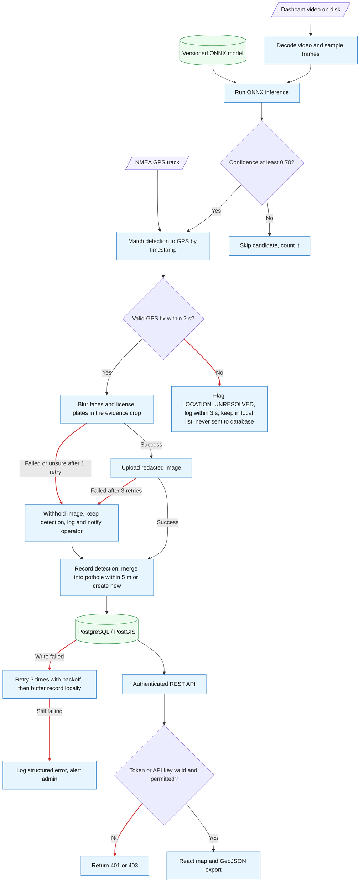
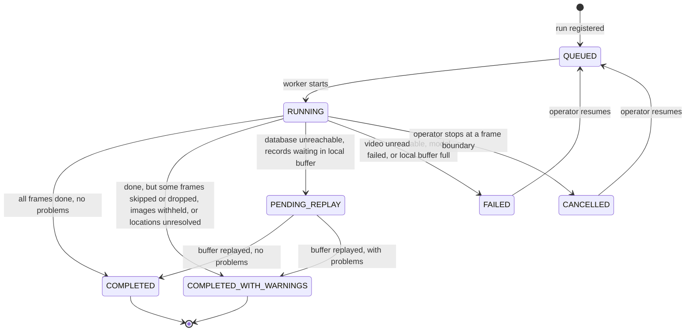
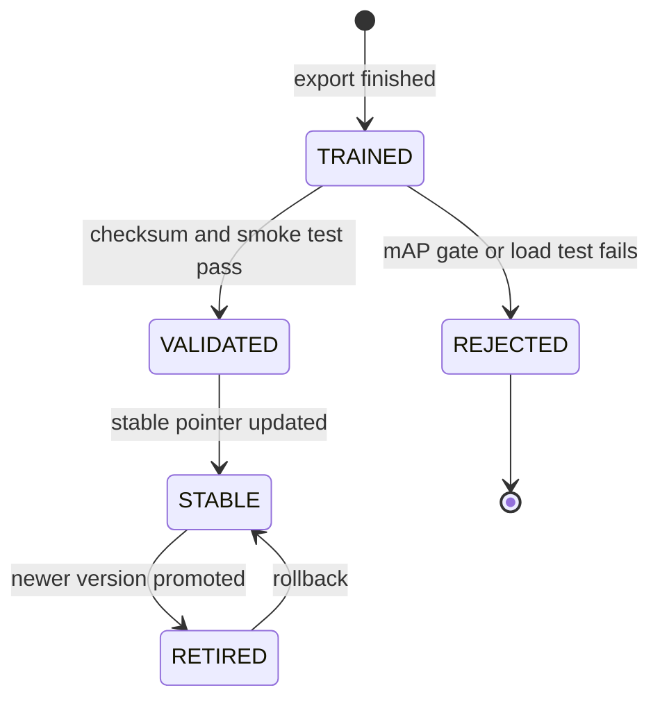

# StreetSmart: Detailed System Design (D2)

**Project:** StreetSmart: Automated Public Infrastructure Damage Detection and Geospatial Reporting System 
**Goal:** Analyze vehicle-mounted camera footage and synchronized GPS data to detect, geotag, and classify roadway damage; store validated records; and expose them through a municipal-facing map and standardized API. 
**Team Members:** Advait Vagerwal, Sahil Thakare, Raihan Rafeek 
**Course:** CS 5001 – Computer Science Senior Design 
**Advisor:** Eric Jamison 
**Assignment:** Assignment 7 - Detailed System Design, Part 2 (D2) 
**Document Version:** Draft 1.3 
**Date:** October 13, 2026

---

# 1. Header, Conventions, and D2 Overview

## 1.1 Project goal

StreetSmart is a prototype tool for inspecting public roads. It works in batches on recorded dashcam video and matching GPS tracks. It:

1. finds potholes and other municipal damage in the video with an ONNX object-detection model,
2. attaches GPS coordinates to each detection,
3. blurs faces and license plates in the evidence photo _before_ the photo is saved anywhere,
4. shows the records on a web map and through a REST API.

This prototype supports municipal review and GIS export. It is not a production work-order system, rather a proof of concept to understand the constraints in the real world.

## 1.2 Diagram conventions

These conventions apply to every diagram in this document. Each figure repeats them in its caption. They are the same shapes and colors used in D0.

|Notation|Meaning|
|---|---|
|Blue rectangle|A StreetSmart software component|
|Green cylinder|Saved data (database) or a versioned model file|
|Orange dashed rectangle|Something outside StreetSmart (device, third-party service)|
|Purple parallelogram|A file or data set entering or leaving the system|
|Solid arrow|A direct call or the main flow of data|
|Dashed arrow|A call to an outside service, or a batch/background flow|
|Diamond|A yes/no decision|
|**Red arrow**|An error or failure path|
|`PK` / `FK`|Primary key / foreign key (a table's unique ID / a link to another table)|
|`I1`–`I10`|Interface IDs from D0 (kept; §2.14 lists which contents were revised)|
|`E-nn`|Edge-case ID from the register in §3|
|`US-*`, `AC-*`, `NFR-*`|Requirement IDs (user story, acceptance criterion, non-functional requirement)|

In the data-model diagram (D1), boxes are tables, listed items are fields, and lines with crow's-foot ends show relationships. Locations use WGS84 (EPSG:4326). In GeoJSON, coordinates are written longitude first, then latitude.

## 1.3 Two-minute overview

StreetSmart finds potholes and other public infrastructure damage in recorded driving video, works out where each one is using GPS data, and stores it in a central database. City staff can view those records on a map or pull them into their own GIS tools through an external API.

In our previous design documents, we discussed the following:
- **D0: High-Level Architecture**
    - Established how StreetSmart's major components fit together, from training the pothole detection model to processing vehicle footage, storing detected road damage, and displaying results on an infrastructure map.
    - Defined ten interfaces (I1–I10) describing how components communicate, the main data flows, timing budgets, and five architecture decisions. These establish the system's overall structure and constraints for implementation.
- **D1: Detailed Data and API Design**
    - Defined the database schema for `VIDEO_RUN`, `POTHOLE`, `DETECTION`, and `EVIDENCE_IMAGE`, specifying how video-processing runs, detected potholes, individual sightings, and supporting images respectively are represented and related.
    - Established the weighted confidence formula and 5 m spatial matching rule to help assess detection reliability and consolidate repeated sightings of the same pothole.
    - Specified core API contracts, evidence-image storage handling, and technology choices, including Go/Gin, React, and Supabase. These define how the frontend and backend exchange data and how StreetSmart stores and exposes detection results.
    - Deferred the detailed designs for Model Training, Trained Model Storage, Model Inference, and the Current Infrastructure Map to D2, where their behavior, interfaces, and failure handling are specified.

**What D2 adds.**

- A data model, behavior, and interface for every remaining component, plus the Ingestion Pipeline's D2 view and the shared services (configuration, authentication, logging, notifications).
- Two lifecycle diagrams and one diagram that shows error paths (Figures 2.1–2.3).
- A table of edge cases and how each is handled (§3).
- A table linking each requirement to the design elements that satisfy it, in both directions (§4). This becomes the Week 9 traceability matrix.
- Design rationale (§5) and a template for the peer review notes (§6).

## 1.4 Known gaps and open questions

| #   | Gap or question                                                                                | Decision made in this draft                                                                                                                                                                                                                                                                                                                                                                                                                                                               | Still open                                                                                                                      | Owner          |
| --- | ---------------------------------------------------------------------------------------------- | ----------------------------------------------------------------------------------------------------------------------------------------------------------------------------------------------------------------------------------------------------------------------------------------------------------------------------------------------------------------------------------------------------------------------------------------------------------------------------------------- | ------------------------------------------------------------------------------------------------------------------------------- | -------------- |
| 1   | What to do when blurring faces/plates fails or is uncertain                                    | Retry once. If it still fails, **do not save the image**, but keep the detection. D1 already allows a detection with zero images. The event is recorded in logs and the run summary (E-15). This extends D0 Decision 5: an unblurred image is never stored.                                                                                                                                                                                                                               | How well does the redaction model actually perform (needs test results)? Do municipal users need to know an image was withheld? | Advait         |
| 2   | Pothole status values and who may change them                                                  | D1 stores `POTHOLE.status` without a value list. D0's example uses `review_status: "UNRESOLVED"` and D1 mentions "unresolved vs. repaired". Draft values: `UNRESOLVED` (not yet repaired, the default), `REPAIRED`, and `NEEDS_REVIEW` (set by an ambiguous match, see #5). We are discussion with stakeholders as to who gets to change this.                                                                                                                                            | Final status values; who may change them, and whether editing is added later.                                                   | Raihan         |
| 3   | How video frames are matched to GPS points                                                     | D0 says to match by linear interpolation. Rule: interpolate between the two GPS fixes on either side of the detection if both are within 2 seconds and have a valid fix quality; otherwise use the nearest fix if it is within 2 seconds; otherwise the location is unresolved. An unresolved detection is flagged `LOCATION_UNRESOLVED`, logged within 3 s, kept in a cache for reprocessing, and **never sent to the database** (D0: blocked from external transfer; D1: `422`) (E-17). | Is 2 seconds the right limit? Frame times are computed from the run's `started_at`; confirm it is the recording start time.     | Raihan         |
| 4   | Two workers simultaneously process detections of the same physical pothole.                    | Ensure concurrent workers cannot create duplicate `POTHOLE` records for the same location. Preserve legitimate `DETECTION` records from separate frames or video runs so repeated sightings can contribute to confidence scoring. Retain the `(video_run_id, frame_index)` duplicate check for repeated processing of the same frame.                                                                                                                                                     | Load-test with several workers at once.                                                                                         | Raihan         |
| 5   | D1's rule for several nearby potholes leaves cases undefined                                   | D1 says: merge if the nearest is within 2.0 m and at least 1.5 m closer than the next; flag ambiguous if the two are within 1.0 m of each other. It says nothing about a gap of 1.0–1.5 m, or a nearest candidate farther than 2.0 m. D2 treats every case that is not clearly closest as **ambiguous**: do not merge; create a new pothole with status `NEEDS_REVIEW` (E-21).                                                                                                            | Team agreement on this reading; test with real data and speak to stakeholders.                                                  | Sahil          |
| 6   | D1's duplicate key allows one detection per frame                                              | This is up to debate. We are currently testing what is the best approach. We are currently leaning towards top 10 confident predictions                                                                                                                                                                                                                                                                                                                                                   | Test and verify the threshold that is best for memory complexity and runtime while not sacrificing functionality                | Raihan         |
| 7   | Two ways to write detections: D0 I7 (direct database write) and D1 (`POST /api/v1/detections`) | Both call the same `RecordDetection` function, so the rules are identical. The Ingestion Pipeline uses I7 directly by default; the POST endpoints are for remote workers and testing (§2.16).                                                                                                                                                                                                                                                                                             | Confirm with the team, and decide whether the POST endpoints stay in the prototype.                                             | Raihan         |
| 8   | Secrets, data retention, backups, access control                                               | Secrets come from environment variables or a secret store and are never committed to Git (§2.11).                                                                                                                                                                                                                                                                                                                                                                                         | Retention period, backup plan, who gets which role.                                                                             | Sahil          |
| 9   | Which identity provider issues login tokens, and how city API keys are issued                  | D0 uses a bearer JWT for the map (I9) and an API key for city systems (I10). Both are supported (§2.10).                                                                                                                                                                                                                                                                                                                                                                                  | Pick the identity provider; decide how API keys are issued and rotated.                                                         | Raihan / Sahil |


## 1.5 Glossary

| Term                                  | Meaning in this document                                                                                                                      |
| ------------------------------------- | --------------------------------------------------------------------------------------------------------------------------------------------- |
| ONNX                                  | A standard file format for trained AI models, so the model can run without the training software                                              |
| YOLO                                  | The family of object-detection models we train                                                                                                |
| mAP                                   | A standard score for how well a detector finds and outlines objects (higher is better)                                                        |
| PostGIS                               | A PostgreSQL add-on that understands maps (distances, areas, spatial search)                                                                  |
| GeoJSON                               | A standard text format for map data that GIS tools can read                                                                                   |
| NMEA                                  | The text format GPS devices record their position in                                                                                          |
| Confidence                            | A number from 0 to 1 showing how sure the model is that it saw a pothole                                                                      |
| Bounded retry                         | Try again a fixed number of times (with short waits), then give up and report the failure                                                     |
| Local buffer                          | A file on the worker's own disk where records wait if the database is unreachable, so nothing is lost                                         |
| Duplicate check                       | If the same detection (same run and frame) is sent twice, the system recognizes it and counts it only once                                    |
| Block by default                      | If we can't confirm a request or image is safe, we refuse it instead of letting it through                                                    |
| Bearer token (JWT)                    | The login proof a signed-in user's browser sends with each API request                                                                        |
| API key                               | A secret string issued to one city system so it can call the export endpoint                                                                  |
| Correlation ID                        | A unique ID attached to a request or run so all its log lines can be found together                                                           |
| Atomic                                | Happens completely or not at all; never half done                                                                                             |
| Spatial index (GiST)                  | A database index that makes "what is near here?" queries fast                                                                                 |
| Supabase                              | The external service that hosts the database and stores the redacted evidence images                                                          |


---

# 2. Finished Components: D2 Design

## 2.1 Main flow with error paths

**StreetSmart: Automated Public Infrastructure Damage Detection and Geospatial Reporting System** 
**Goal:** Convert vehicle video and GPS into privacy-redacted, geotagged pothole records that municipal users can inspect and export.




| Category                          | Description                                                                                                                                                                    | Related Edge Cases |
| --------------------------------- | ------------------------------------------------------------------------------------------------------------------------------------------------------------------------------ | ------------------ |
| Caption and conventions           | Blue represents StreetSmart components; green represents stored data or models; purple represents input files; diamonds represent decisions; red arrows represent error paths. | —                  |
| Missing GPS location              | A detection without a usable GPS location is held back and never reaches the database, so it cannot appear on the map or in an export.                                         | E-15, E-17         |
| Redaction or upload failure       | A failed redaction or image upload preserves the detection but drops the associated image.                                                                                     | E-20, E-24         |
| Database write failure            | Records wait in a local buffer, and an administrator is alerted if the database cannot be written to.                                                                          | E-32, E-33         |
| Authentication and key validation | Failed login attempts and invalid keys have defined outcomes.                                                                                                                  | E-50               |

## 2.2 Lifecycle state machines

**Figure 2.2: Video run lifecycle** (`VIDEO_RUN.processing_status`, updated by the worker; held locally while the database is unreachable). Related: E-12, E-13, E-14, E-24.


A video run represents one attempt to process a dashcam video and its associated GPS data. The `VIDEO_RUN` record tracks the job's status from registration through processing to completion, failure, or cancellation. If the database becomes unavailable, the run may enter a pending state while records await persistence.

| Status                    | Meaning                                                                                                          |
| ------------------------- | ---------------------------------------------------------------------------------------------------------------- |
| `QUEUED`                  | The video is registered and waiting for a worker to process it.                                                  |
| `RUNNING`                 | A worker is actively processing video frames and identifying potential potholes.                                 |
| `COMPLETED`               | Processing finished successfully without issues.                                                                 |
| `COMPLETED_WITH_WARNINGS` | Processing finished, but some frames, GPS locations, or evidence images had issues.                              |
| `PENDING_REPLAY`          | The database is unavailable, and records are waiting in a local buffer to be retried.                            |
| `FAILED`                  | Processing stopped because of a serious error, such as an unreadable video, model failure, or full local buffer. |
| `CANCELLED`               | An operator stopped processing at a frame boundary.                                                              |


**Figure 2.3: Model version lifecycle** (`ModelManifest.release_status`). Related: E-03, E-05, E-06, E-07, E-51.



**Caption and conventions (both figures):** Each box is a status; each arrow is the event that moves it to the next status. Only `STABLE` models are used by inference.

## 2.3 Component: Model Training

### Data model

Training reads a labeled image data set (public sets such as RDD2022 and Roboflow pothole sets, plus our own annotated images) and produces two files that stay together: the ONNX model and a manifest. The manifest holds model version, data set version, class labels, input size, training settings, validation scores, export time, and a checksum (a fingerprint used to detect corrupted files).

### Behavior

1. Load the data set manifest and check that each image has a matching annotation file.
2. Reject unreadable images, broken annotations, bounding boxes outside the image, and unknown class IDs. Log each rejected sample and why.
3. Stop before training if more than 5% of samples are invalid (D0 rule).
4. Fine-tune the YOLO-family detector in PyTorch using the settings committed to the repository.
5. Test on a held-out validation set and record precision, recall, and mAP@0.5.
6. Export to ONNX only if mAP@0.5 is **greater than 0.75** (D0 release gate), then check that the exported model loads and has the expected input/output shape.
7. Write the files to a temporary location, calculate the checksum, then promote them as a new version in one atomic step.
8. If testing or export fails, keep the previous stable model and report the failure. A failed model never replaces the stable one.

### Interface

| Interface | Direction                | Contents                                                                                                                   |
| --------- | ------------------------ | -------------------------------------------------------------------------------------------------------------------------- |
| I1        | Data set → training      | Kept as in D0: in `image_files[]`, `annotations[]` (YOLO text), `classes[]`; out `dataset_manifest`, `validated_pairs`     |
| I2        | Training → model storage | `ModelPackage { onnx_model, export_manifest }`. Metrics and version live inside the manifest (revised from D0, see §2.14). |

### Errors

| Error condition                           | Error code             | System response                             | Recoverable? |
| ----------------------------------------- | ---------------------- | ------------------------------------------- | ------------ |
| Too many invalid samples, or none valid   | `DATASET_INVALID`      | Write a validation report and stop training | After fix    |
| Training diverges (scores blow up)        | `TRAINING_DIVERGED`    | Stop training; do not promote               | After fix    |
| mAP@0.5 not above 0.75                    | `METRIC_GATE_FAILED`   | Do not promote; keep previous stable model  | After fix    |
| Export fails or exported model won't load | `EXPORT_FAILED`        | Keep previous stable model                  | After fix    |
| Disk full or no permission                | `STORAGE_WRITE_FAILED` | Stop and report to operator                 | After fix    |

**Primary owner:** Advait Vagerwal.

## 2.4 Component: Trained Model Storage

### Data model

Each model has a manifest with `model_version`, `artifact_path`, `checksum_sha256`, `input_name`, `input_shape`, `output_name`, `output_shape`, `class_labels`, `created_at`, `validation_metrics`, and `release_status` (see Figure 2.3). Promoted model files never change. A separate "stable pointer" says which version inference should use.

### Behavior

1. Accept a model only from the training/export workflow.
2. Check that the manifest is complete and that the checksum matches the file.
3. Save the file under a version-specific name. Never overwrite an existing version.
4. Move the stable pointer to the new version only after all checks pass.
5. Give the model's details to inference when it starts.
6. Keep the previous stable model until the new one passes load and smoke tests.
7. If a requested version is missing or damaged, refuse to start inference instead of quietly loading some other file.

### Interface

| Interface | Direction           | Contents                                                                                                                                                                              |
| --------- | ------------------- | ------------------------------------------------------------------------------------------------------------------------------------------------------------------------------------- |
| I2        | Training → storage  | `ModelPackage` (see above)                                                                                                                                                            |
| I3        | Storage → inference | `ResolveModel(version string) (ModelHandle, error)` where `ModelHandle { version, checksum, tensor_spec }`. The execution provider (CUDA, DirectML, or CPU) comes from configuration. |


Inference must never start with a model that fails its integrity check.

### Errors

|Error condition|Error code|System response|Recoverable?|
|---|---|---|---|
|Model file missing|`MODEL_NOT_FOUND`|Refuse to load; report which version is missing|After fix|
|Checksum does not match|`MODEL_CHECKSUM_MISMATCH`|Refuse to load; notify operator (file may be corrupt)|After fix|
|Manifest incomplete or invalid|`MODEL_MANIFEST_INVALID`|Reject the manifest; report what is wrong|After fix|
|Storage unavailable|`MODEL_STORAGE_UNAVAILABLE`|Retry reads 3 times, then refuse to load|Yes, once storage returns|

**Primary owner:** Advait Vagerwal.

## 2.5 Component: Model Inference

### Data model

Inference keeps no saved data of its own. It reads the video file from disk a piece at a time and holds only the current frame and its candidate detections in memory. Everything durable goes into `VIDEO_RUN`, `DETECTION`, `POTHOLE`, and `EVIDENCE_IMAGE` through the Ingestion Pipeline.

### Behavior

1. Get the model with `ResolveModel`, verify its checksum and input/output shape, and create the ONNX Runtime session with the configured execution provider.
2. Open the video file (GoCV/OpenCV) and decode frames one at a time. Never load the whole video into memory.
3. Pick frames to analyze using the configured sampling rate (§2.11).
4. Resize and normalize each chosen frame to the model's 3 × 640 × 640 input.
5. Run ONNX Runtime from the Go pipeline.
6. Turn the model output into candidate boxes with a class and confidence.
7. Discard malformed boxes and anything below `0.70` confidence.
8. If several candidates remain in one frame, keep only the highest-confidence one (D1 allows one detection per run and frame; see §1.4 #6).
9. Crop the evidence image with the box drawn on it, and send a `DetectionEvent` to the Ingestion Pipeline over the local socket (I6). If the send fails, retry up to 3 times; then drop the frame, log it, and count a warning (D0).
10. If a frame is corrupt, skip it and continue from the next valid keyframe (D0). Mark the run failed only if the video can no longer be decoded or the model/runtime fails.
11. Set the run status to `COMPLETED`, `COMPLETED_WITH_WARNINGS`, `PENDING_REPLAY`, or `FAILED` (Figure 2.2).

### Interface

| Interface | Direction                               | Purpose and Contents                                                                                                                                                                                                                                                                                                                                                                                                                                                                                                                                                                                                                                                                                                                                                                           |
| --------- | --------------------------------------- | ---------------------------------------------------------------------------------------------------------------------------------------------------------------------------------------------------------------------------------------------------------------------------------------------------------------------------------------------------------------------------------------------------------------------------------------------------------------------------------------------------------------------------------------------------------------------------------------------------------------------------------------------------------------------------------------------------------------------------------------------------------------------------------------------- |
| I3        | Trained Model Storage → Model Inference | Provides the inference component with a loaded `ModelHandle`, which represents the trained model and its associated inference resources. The handle allows inference to execute predictions without needing to know how the model is stored or loaded. If the model is missing or fails integrity validation, it must not be made available for inference.                                                                                                                                                                                                                                                                                                                                                                                                                                     |
| I4        | Caller → Model Inference                | The caller starts video processing using `ProcessVideo(ctx, job InferenceJob) (RunSummary, error)`. The `InferenceJob` contains `run_id`, which identifies the video-processing run, and `video_ref`, which identifies the input video. The inference component decodes the video, processes its frames using the loaded model, and passes detection events to ingestion. Frame rate and timestamps are derived from the video file. Decoded frames remain internal to inference rather than being passed through the interface. The method returns a `RunSummary` describing the processing outcome or an error if processing cannot proceed or fails.                                                                                                                                        |
| I6        | Model Inference → Ingestion Pipeline    | Sends individual detection events to the ingestion pipeline through a local Unix domain socket. Each `DetectionEvent` contains `run_id` to associate the detection with its video run; `frame_index` and `frame_timestamp` to identify when it occurred; `damage_type` and `model_confidence` to describe the predicted road damage and the model's confidence; `bbox{x_min, y_min, x_max, y_max}` to locate the detected region within the frame; and `crop_image`, which contains the corresponding cropped image for downstream evidence handling. Ingestion uses this information to associate detections with GPS coordinates, apply matching and confidence logic, and persist eligible records. Invalid events or delivery failures must be handled without silently losing detections. |

**Performance target:** process 60 minutes of footage within 1,200 seconds / 20 minutes (AC-01.1). This is a target to test on the agreed hardware, not a measured result.

### Errors

| Error condition                                    | Error code          | System response                                                          | Recoverable? |
| -------------------------------------------------- | ------------------- | ------------------------------------------------------------------------ | ------------ |
| One frame is corrupt                               | `FRAME_CORRUPT`     | Skip it, continue from the next valid keyframe, add to the warning count | Yes          |
| Video missing, unsupported, or too damaged to read | `VIDEO_UNREADABLE`  | Mark run `FAILED`                                                        | After fix    |
| Model fails to load, or execution provider missing | `MODEL_LOAD_FAILED` | Stop startup, log a critical error, alert the operator                   | After fix    |
| Model fails while running                          | `INFERENCE_FAILED`  | Stop the run, log a critical error, notify operator                      | After fix    |
| Sending a detection over the socket fails          | `IPC_SEND_FAILED`   | Retry up to 3 times; then drop the frame, log it, count a warning        | Partial      |

**Primary owner:** Raihan Rafeek.

## 2.6 Component: Ingestion Pipeline

D1 defined the matching and confidence rules. This is the D2 view of the pipeline's data, behavior, and errors. It is the Go service (`internal/ingestion`) that connects detections, GPS, evidence images, and the database.

### Data model

No saved data of its own, except two small local files on the worker: the **local buffer** (records waiting for the database) and the **unresolved list** (detections with no usable location). Records sent to the database use D1's fields: `run_id`, `frame_index`, `detected_at`, `model_confidence`, `damage_type`, `latitude`, `longitude`, and optional `image_path`.

### Behavior

1. Read the recorded NMEA track once (I5) into a list of GPS fixes.
2. Receive a `DetectionEvent` (I6) from inference.
3. Check confidence (0 to 1) and timestamp. Discard redundant detections from stationary periods (D0 §6), using the GPS-derived speed.
4. Find the location (rule in §1.4 #3). If none qualifies, flag `LOCATION_UNRESOLVED`, log within 3 seconds (AC-01.2), add the detection to the unresolved list, count a run warning, and stop here. The database is never called.
5. Blur faces and license plates in the evidence crop (Haar cascade or a lightweight YOLO model, per D1 §4). If the result is invalid or uncertain, retry once; if it still fails, withhold the image.
6. Upload the redacted image to Supabase Storage. Retry up to 3 times; if it still fails, withhold the image.
7. Call `RecordDetection` (I7) with the record, including `image_path` only if an image was saved. On failure, retry up to 3 times with exponential backoff (D0).
8. If all 3 attempts fail, write the record to the local buffer and alert the admin (D0). Keep processing. Replay the buffer when the database returns; the duplicate check makes replays safe.
9. Treat a created, merged, or duplicate result as success.

### Interface

| Interface | Direction             | Contents                                                                |
| --------- | --------------------- | ----------------------------------------------------------------------- |
| I5        | GPS → ingestion       | Recorded NMEA file parsed into `GpsFix { time, lat, lon, fix_quality }` |
| I6        | Inference → ingestion | `DetectionEvent` (see §2.5)                                             |
| I7        | Ingestion → database  | `RecordDetection(rec DetectionRecord) (RecordResult, error)`            |

### Errors

|Error condition|Error code|System response|Recoverable?|
|---|---|---|---|
|Confidence or coordinates out of range|`DETECTION_INVALID`|Reject the detection; log it|After fix|
|No usable GPS location|`LOCATION_UNRESOLVED`|Flag, log within 3 s, keep in unresolved list, never send to database|Partial|
|Same run and frame recorded twice|`DUPLICATE_DETECTION`|Return the existing detection ID; do not count twice|Yes|
|Redaction fails or is uncertain|`PRIVACY_IMAGE_OMITTED`|Retry once, then record the detection without an image; notify operator|Partial|
|Image upload fails|`IMAGE_UPLOAD_FAILED`|Retry 3 times, then record the detection without an image|Partial|
|Database write fails|`DB_WRITE_FAILED`|Retry 3 times with backoff; then buffer locally and alert admin|Yes|
|Local buffer full|`BUFFER_FULL`|Stop at a frame boundary, mark run `FAILED`, alert admin; buffered records are kept|After fix|

**Primary owner:** Raihan Rafeek.

## 2.7 Component: Current Infrastructure Map

### Data model

No saved data. The browser (React with TypeScript and MapLibre GL, per D1 §6.3) keeps: current map area (bounding box), filters, current results, selected pothole ID, loading/error state, and result limit. Login credentials follow the identity provider's rules and are never written to logs.

### Behavior

1. Load the map and set the starting view.
2. Ask the API for potholes in the visible area, with optional confidence and status filters. (D0's "severity filter" becomes confidence and status filters, see §1.4 #10.)
3. Draw the returned GeoJSON as markers or clusters.
4. When the map moves or filters change, wait briefly (debounce) before asking again, and ignore any answer that arrives after a newer request. Target: a viewport query returns within 2.0 seconds (D0 §5).
5. When a marker is selected, show that pothole's details and its redacted evidence images.
6. Show clear states for: loading, no results, partial data, not signed in, and service unavailable.
7. Show `NEEDS_REVIEW` potholes with a distinct label (not by color alone).
8. Make controls usable by keyboard with accessible labels, following WCAG 2.1 AA (D0 §6). Never use color alone to show status.

Detections with no usable location never reach the database (§2.6), so no unlocated record can reach the map.

### Interface

|Interface|Request|Response|
|---|---|---|
|I9|`GET /api/v1/potholes?bbox=min_lon,min_lat,max_lon,max_lat&min_confidence=0.70&status=ALL&limit=100` with a bearer JWT|GeoJSON FeatureCollection (RFC 7946)|
|I9 (details)|`GET /api/v1/potholes/{id}`|Pothole detail object|

### Errors (what the user sees)

| Error condition                   | HTTP status             | Map response                                                    | Recoverable?            |
| --------------------------------- | ----------------------- | --------------------------------------------------------------- | ----------------------- |
| Invalid filters                   | `400`                   | Explain which filter is invalid                                 | Yes                     |
| Not signed in or session expired  | `401`                   | Send the user to the sign-in page and show a clear message (D0) | Yes                     |
| Signed in without permission      | `403`                   | Show "insufficient permission"                                  | After fix (role change) |
| Selected pothole no longer exists | `404`                   | Say the record was removed; refresh                             | Yes                     |
| Too many requests                 | `429`                   | Back off, then retry                                            | Yes                     |
| Service unavailable or no network | `503` / network error   | Keep old map data, show a stale-data warning, offer Retry       | Yes                     |
| Malformed GeoJSON                 | (response body invalid) | Keep last valid display, show a data error                      | After fix               |

**Primary owner:** Sahil Thakare.

## 2.8 Component: PostgreSQL/PostGIS Database

### Data model

D2 keeps D1's four tables and diagram unchanged: `VIDEO_RUN`, `POTHOLE`, `DETECTION`, and `EVIDENCE_IMAGE`. Rules the database enforces:

- Every `DETECTION.video_run_id` points to an existing `VIDEO_RUN`.
- Every matched `DETECTION.pothole_id` points to one `POTHOLE`.
- Every `EVIDENCE_IMAGE.detection_id` points to a `DETECTION`.
- `model_confidence` and `aggregated_confidence` are between 0 and 1.
- Frame indexes are zero or higher; timestamps include a time zone.
- Locations are valid EPSG:4326 points.
- An evidence-image row is added only after the redacted image upload succeeded (D1 §2.5).
- **Duplicate check (D2 implementation of D1 §3.1):** a unique constraint on `(video_run_id, frame_index)` on `DETECTION`. D1 requires this check; the constraint makes the database enforce it, even if two workers send the same frame at once. No new columns.
- Allowed `POTHOLE.status` values in this draft: `UNRESOLVED`, `REPAIRED`, `NEEDS_REVIEW` (see §1.4 #2).
- Allowed `VIDEO_RUN.processing_status` values: see Figure 2.2.

### Behavior

1. Accept validated records from the ingestion service (I7).
2. In one transaction, find a matching pothole, insert the detection, and update the pothole's confidence and count.
3. **Matching (D1 §3.2):** search for potholes within 5.0 m using `ST_DWithin`, which includes exactly 5.0 m. With no candidate, create a new pothole. With one candidate, merge. With several, merge only if the nearest is within 2.0 m **and** at least 1.5 m closer than the next one (D1). Every other case is **ambiguous**: do not merge; create a new pothole with status `NEEDS_REVIEW` (this includes the cases D1 leaves undefined, see §1.4 #5).
4. **Concurrency (D2):** before matching, take a lock on the geographic grid cell (and neighboring cells, always in the same order to avoid deadlock) so two workers cannot both create a pothole for the same spot.
5. Commit only if all the rules above hold.
6. Serve map-area and detail queries to the API using parameterized statements (user input is never pasted into SQL text).
7. Return errors to the caller. Never silently drop a record.

### Interface

|Interface|Direction|Contents|
|---|---|---|
|I7|Ingestion → database|`RecordDetection(DetectionRecord) (RecordResult, error)`. The database layer generates the IDs.|
|I8|Database → API|`FindPotholes(bbox, filters, limit) ([]PotholeSummary, error)` and `GetPothole(id) (PotholeDetail, error)`. No SQL text and no raw table rows cross this interface.|

### Errors

|Error condition|Error code|System response|Recoverable?|
|---|---|---|---|
|Rule violated (foreign key, unique, check)|`CONSTRAINT_VIOLATION`|Roll back; return a safe validation or duplicate error|After fix|
|Brief conflict or deadlock|`TX_CONFLICT`|Retry the whole transaction with short random waits|Yes|
|Connection unavailable (write)|`DB_UNAVAILABLE`|Caller retries 3 times with backoff, then buffers locally (§2.6)|Yes, once DB returns|
|Connection unavailable (read)|`DB_UNAVAILABLE`|API returns `503` and resets its connection pool (D0 I8)|Yes, once DB returns|
|Query too slow|`QUERY_TIMEOUT`|Cancel the query; return `503`|Yes|

**Primary owner:** Raihan Rafeek.

## 2.9 Component: Backend API

### Data model

The API sends and receives purpose-built request/response shapes, never raw database rows: `CreateRunRequest/Response`, `CreateDetectionRequest/Response`, `PotholeFeature`, `PotholeDetail`, and `ProblemDetails` (the error format). Responses never include database connection details, stack traces, secrets, or unlocated coordinates.

### Behavior

1. Enforce request-size and content-type limits.
2. Check the credential (bearer JWT or API key) and the caller's permission (§2.10).
3. Validate path parameters, query parameters, coordinate ranges, confidence values, and timestamps.
4. Use parameterized SQL and a limited-size connection pool.
5. Return map data as GeoJSON with coordinates as `[longitude, latitude]`. Evidence images are returned as time-limited signed URLs.
6. Return every error in the same format, with an HTTP status and a request ID.
7. Apply timeouts and rate limits.
8. Log request details and results, but never tokens, API keys, secrets, or raw image content.

### Interface

D0 shows the API as read-only (I8 in, I9/I10 out). The first four rows are D1's endpoints, which D2 keeps with D1's inputs and success responses. The last two rows are D2 additions (§2.15).

|Method and path|Purpose|Success|Required permission|
|---|---|---|---|
|`POST /api/v1/runs`|Register a video run|`201 Created` with `run_id`, status `QUEUED`|`operator`|
|`POST /api/v1/detections`|Submit one detection (same operation as I7)|`201 Created` with detection ID, pothole ID, aggregate score, and `match_action` (`MERGED`, `CREATED`, or `AMBIGUOUS`)|`operator`|
|`GET /api/v1/potholes`|Pothole query for the map|`200 OK` GeoJSON|`viewer`|
|`GET /api/v1/potholes/{id}`|Pothole details|`200 OK` detail object|`viewer`|
|`PATCH /api/v1/runs/{id}` (D2)|Update a run's status (Figure 2.2)|`200 OK` with the new status|`operator`|
|`GET /api/v1/export/geojson` (D2)|Export for city GIS systems|`200 OK` GeoJSON plus export metadata|`exporter`|

**Decision (export endpoint):** D0's example error response already uses the path `/api/v1/export/geojson`, but D1's endpoint table does not list it. D2 adds it as a dedicated endpoint. It follows the same bounding-box and limit rules as the map query (maximum 500). The map query defaults to 100 results.

**Interface I10:** HTTPS request (TLS 1.3) with an API key, `export_bbox`, and `format` (only `geojson` is supported); returns RFC 7946 GeoJSON plus export metadata. City systems never connect to PostgreSQL directly (D0 Decision 4).

### Errors

|HTTP status|Error code|When|System response|Recoverable?|
|---|---|---|---|---|
|`400`|`INVALID_PARAMETER`|Bad bounding box, limit, UUID, or malformed JSON|Return problem response with field details; no database change|After fix|
|`401`|`UNAUTHENTICATED`|Missing, expired, or invalid token or API key|Return problem response; no handler runs|After fix|
|`403`|`FORBIDDEN`|Valid credential, missing permission|Return problem response|After fix|
|`404`|`NOT_FOUND`|Run, pothole, or run ID in a detection does not exist|Return problem response|After fix|
|`409`|`DUPLICATE_DETECTION`|Same `(run_id, frame_index)` already recorded (D1)|Return the existing detection ID in the body; no data change. Workers treat this as already done.|Yes|
|`409`|`CONFLICT`|Duplicate run name (D1), or an invalid status change on a run|Return problem response|After fix|
|`422`|`LOCATION_UNRESOLVED` / `DETECTION_INVALID`|No usable GPS location (AC-01.2), or values out of range|Return problem response within 3 s; nothing stored|After fix|
|`429`|`RATE_LIMITED`|Too many requests|Ask client to wait and retry|Yes|
|`500`|`INTERNAL_ERROR`|Unexpected failure|Generic message and request ID; details only in logs|Varies|
|`503`|`DEPENDENCY_UNAVAILABLE`|Database or login provider unavailable|Generic message; reset the database pool; log details|Yes, once restored|

Example error body (same shape as D0's example):

```json
{
  "type": "https://streetsmart.cincinnati-oh.gov/errors/invalid-spatial-parameter",
  "title": "Invalid Coordinate Bounding Box",
  "status": 400,
  "detail": "Requested latitude coordinate '94.2000' exceeds valid WGS84 range [-90.0, 90.0].",
  "instance": "/api/v1/export/geojson?bbox=-84.5,94.2,-84.4,39.1",
  "timestamp": "2026-10-13T15:00:01.045Z",
  "request_id": "generated-correlation-id",
  "invalid_params": [
    {
      "name": "bbox[1]",
      "reason": "Value must be between -90.0 and 90.0 degrees latitude."
    }
  ]
}
```

Responses never contain stack traces or SQL.

**Primary owner:** Raihan Rafeek.

## 2.10 Shared component: Authentication and authorization

### Data model

StreetSmart currently has no user table and stores no passwords. For current prototype purposes, this is intentional. Two kinds of credential are accepted, matching D0:

|Credential|Used by|Interface|How it is checked|
|---|---|---|---|
|Bearer token (JWT) from an identity provider|Map users|I9|Signature, issuer, audience, expiry, and required claims|
|API key issued per city system (or per worker)|City systems, optional remote workers|I10, POST/PATCH endpoints|The key is compared against a stored hash; hashes live in the secret store, not in the database|

Roles:

|Role|Allowed|
|---|---|
|`viewer`|Read the map and pothole details|
|`exporter`|Everything `viewer` can do, plus GeoJSON export|
|`operator`|Register runs, update run status, and submit detections through the API|

### Behavior

1. Require HTTPS.
2. Check the credential. Tokens: signature, issuer, audience, expiry, required claims. API keys: match against the stored hash and check it is not revoked.
3. Allow only what the role permits (least privilege).
4. Missing, invalid, or expired credential → `401`. Valid credential without permission → `403`.
5. Never log tokens, API keys, or secrets.
6. **Block by default:** if a token cannot be checked (for example the provider is down and no valid cached keys exist), refuse the request. Never skip authentication. API-key requests do not depend on the identity provider and keep working during a provider outage.
7. Check a credential once at the start of a request; a request already in progress is not cut off if the token expires mid-way.

### Interface

`AuthenticateAndAuthorize(requiredPermission string) gin.HandlerFunc` (middleware that wraps each protected route).

### Errors

|Error condition|Error code|System response|Recoverable?|
|---|---|---|---|
|Missing or invalid token or API key|`UNAUTHENTICATED` (`401`)|Reject; no handler runs|After fix|
|Expired token|`UNAUTHENTICATED` (`401`)|Reject; client signs in again|Yes|
|Revoked API key|`UNAUTHENTICATED` (`401`)|Reject; log the key's ID (never the key)|After fix|
|Not enough permission|`FORBIDDEN` (`403`)|Reject|After fix|
|Cannot verify token (provider or keys unavailable)|`AUTH_PROVIDER_UNAVAILABLE` (`503`)|Reject and alert; use cached keys only while still valid|Yes, once provider returns|

**Owner:** Raihan Rafeek (API integration). Account, role, and API-key ownership still to be assigned (§1.4 #9).

## 2.11 Shared component: Configuration and secrets

### Data model

No saved data. Settings come from environment variables or a secret store, such as: database URL, storage endpoint and bucket, model version, execution provider, confidence threshold (`0.70`), release gate (`mAP@0.5 > 0.75`), match radius (`5.0 m`), maximum GPS gap (`2 s`), stationary-speed limit, frame sampling rate, API timeouts, retry counts and backoff, local buffer location and size limit, API key hashes, and log level. Credentials are never committed to Git.

### Behavior

1. Load settings at startup.
2. Check that required values exist, numbers are in range, and related settings agree.
3. Stop startup if a required secret is missing or a critical setting is invalid.
4. Use a default only for settings explicitly marked optional.
5. Log setting _names_ and problems, never secret _values_.
6. Freeze settings for the duration of a run (a changed value applies to the next run).

### Interface

`LoadConfig() (Config, error)` and `ValidateConfig(Config) error`.

### Errors

|Error condition|Error code|System response|Recoverable?|
|---|---|---|---|
|Required setting missing|`CONFIG_MISSING`|Stop startup; name the setting|After fix|
|Value out of range|`CONFIG_INVALID`|Stop startup; name the setting and valid range|After fix|
|Optional setting missing|(none)|Use the documented default|Yes|
|Secret store unavailable|`SECRET_STORE_UNAVAILABLE`|Retry startup a few times, then stop|Yes, once store returns|

**Owner:** shared. Raihan: API and inference settings; Sahil: deployment settings (Docker, Supabase) and ingestion settings; Advait: training settings.

## 2.12 Shared component: Structured logging and correlation

### Data model

No saved data model. Each log entry has: timestamp, severity, component, event name, run ID (if any), correlation ID, error code, and a short cleaned message.

### Behavior

1. Create or pass along a correlation ID for each API request and each video run.
2. Log startup/shutdown, run status changes, retries, validation failures, redaction failures, unresolved locations, API errors, and outside-service failures.
3. Remove credentials, tokens, API keys, secrets, and raw image data before writing.
4. Do not log full GPS trails or identifiable image data.
5. Keep per-frame messages at debug level, or log counts instead, so logs don't flood.
6. If the log destination fails, write to standard error and keep processing when safe. A logging failure must never cause a privacy check to be skipped.

### Interface

`LogEvent(level, component, event string, fields map[string]any)`

### Errors

|Error condition|Error code|System response|Recoverable?|
|---|---|---|---|
|Log destination unavailable|`LOG_SINK_UNAVAILABLE`|Write to standard error and continue|Yes (less detail kept)|
|Unsafe or malformed fields|`LOG_FIELD_REJECTED`|Drop the unsafe fields and log a cleaned warning|Yes|

**Owner:** shared; each component owner adds logging to their component.


## 2.13 Interface review: D0 interfaces revisited

D0 interfaces I1–I10 were checked against D0's Interface Specification Table for two problems: **too many parameters**, and **leaking internal details** (file paths, database vocabulary, serial-port settings, SQL text). The D0 interface IDs and connections are unchanged; only their contents were revised.

|Interface|D0 as written|Problem found|Revision|Status|
|---|---|---|---|---|
|I1|In: `image_files`, `annotations`, `classes`. Out: `dataset_manifest`, `validated_pairs`|None|None|Kept|
|I2|In: `trained_weights` (tensor), `training_metrics`, `model_version`. Out: `onnx_model`, `export_manifest`|Passes raw weights between components; metrics and version duplicate the manifest|`ModelPackage { onnx_model, export_manifest }`|Revised|
|I3|In: `model_path`, `execution_provider`. Out: `session`, `input_specs`|Exposes a file path; hands a live session object across the boundary|`ResolveModel(version) → ModelHandle { version, checksum, tensor_spec }`; inference builds its own session; the provider comes from configuration|Revised|
|I4|In: `video_container`, `frame_rate`, `video_id`. Out: `decoded_frame`, `frame_idx`, `relative_ts`|Mentions live V4L2 capture, but the prototype is batch from files (D0 Decision 1); the frame stream is internal to inference|`InferenceJob { run_id, video_ref }`; `video_id` becomes `run_id`; frame rate comes from the file|Revised|
|I5|In: `nmea_sentence`, `baud_rate`. Out: `latitude`, `longitude`, `altitude`, `gps_timestamp`, `fix_quality`|Serial-port settings leak the receiver; one call per sentence; altitude is not stored in D1|Read the recorded NMEA file once into `GpsFix { time, lat, lon, fix_quality }`; live serial input is out of scope|Revised|
|I6|In: `decoded_frame`, `frame_idx`, `relative_ts`. Out: `damage_type`, `confidence`, `bbox`, `crop_image`, `frame_timestamp`|Passes a full frame tensor as input; the output has **no run ID and no frame index**, which the duplicate check needs; `confidence` differs from D1's `model_confidence`|`DetectionEvent { run_id, frame_index, frame_timestamp, damage_type, model_confidence, bbox, crop_image }`|Revised|
|I7|In: `record_id`, `damage_type`, `confidence`, `geom`, `detected_at`, `image_url`, `status`. Out: `db_status`, `rows_affected`, `inserted_id`|Seven loose fields; leaks database vocabulary; `image_url` where D1 stores a relative path; no run ID or frame index; caller sets `status`|`RecordDetection(DetectionRecord) → RecordResult { detection_id, pothole_id, match_action, aggregated_confidence, observation_count }`, matching D1's POST body and response|Revised|
|I8|In: `sql_query`, `params` (bbox, date_range, min_conf). Out: `record_set`|The API passes raw SQL across the boundary; `date_range` is not in D1's API|`FindPotholes(bbox, filters, limit)` and `GetPothole(id)` returning `PotholeSummary` / `PotholeDetail`|Revised|
|I9|In: `http_request`, `auth_token`, `query_params`. Out: `geojson_data`, `feature_count`, `http_status`|None|Defaults documented (`limit=100`, `min_confidence=0.70`), as in D1|Kept|
|I10|In: `http_request`, `api_key`, `export_bbox`, `format`. Out: `geojson_features`, `export_meta`, `http_status`|Endpoint path was not in D1's table|Dedicated `GET /api/v1/export/geojson`; `format` is only `geojson` (§2.9)|Decided|

---

# 3. Edge Cases and Error Handling

All four categories (boundary values, timing and concurrency, bad or missing input, external dependencies) are covered for every component. **Behavior** is one of: Retry, Degrade (keep going with reduced output), Fall back, or Surface error. **Recoverable?** means: _Yes_ = the system continues on its own with no data loss; _Partial_ = it continues but some output is withheld or reduced; _After fix_ = a person must correct the input, configuration, or dependency first (no data lost). E-50 and E-51 were added last and are listed at the end of the table.

| ID   | Component                           | Category            | Edge case                                                                                | Behavior and decision                                                                                                                                                                                                                                                                                                                        | Handler                                              | Recoverable?                         |
| ---- | ----------------------------------- | ------------------- | ---------------------------------------------------------------------------------------- | -------------------------------------------------------------------------------------------------------------------------------------------------------------------------------------------------------------------------------------------------------------------------------------------------------------------------------------------- | ---------------------------------------------------- | ------------------------------------ |
| E-01 | Model Training                      | Boundary values     | Data set has zero valid image/annotation pairs                                           | **Surface error:** stop before training and write a validation report                                                                                                                                                                                                                                                                        | `DatasetValidator`                                   | After fix                            |
| E-02 | Model Training                      | Boundary values     | More than 5% of samples are invalid                                                      | **Surface error:** stop training (D0 rule); nothing is promoted                                                                                                                                                                                                                                                                              | `DatasetValidator`                                   | After fix                            |
| E-03 | Model Training                      | Timing/concurrency  | Two training jobs try to promote a model at once                                         | **Retry:** a version lock lets one win; the other re-checks against the new stable version and retries once                                                                                                                                                                                                                                  | `ArtifactPromoter`                                   | Yes                                  |
| E-04 | Model Training                      | Bad/missing input   | Annotation file missing, corrupt, or box outside the image                               | **Degrade:** skip the sample and log file and reason; stop only if invalid samples pass 5%                                                                                                                                                                                                                                                   | `DatasetValidator`                                   | Yes                                  |
| E-05 | Model Training                      | External dependency | Training process or disk fails during export                                             | **Fall back:** write to a temporary path and promote only after checksum and smoke test pass; previous stable model stays active                                                                                                                                                                                                             | `ArtifactPromoter`                                   | Yes                                  |
| E-06 | Trained Model Storage               | Boundary values     | Empty model file or incomplete manifest                                                  | **Surface error:** reject and leave the stable pointer unchanged                                                                                                                                                                                                                                                                             | `ModelArtifactValidator`                             | After fix                            |
| E-07 | Trained Model Storage               | Timing/concurrency  | Inference asks for the model while a new version is being promoted                       | **Fall back:** a running session keeps the version it already loaded; new sessions read the updated pointer                                                                                                                                                                                                                                  | `ModelResolver`                                      | Yes                                  |
| E-08 | Trained Model Storage               | Bad/missing input   | Requested model version does not exist                                                   | **Surface error:** `MODEL_NOT_FOUND`; inference won't start and never guesses a version                                                                                                                                                                                                                                                      | `ModelResolver`                                      | After fix                            |
| E-09 | Trained Model Storage               | External dependency | Storage unavailable, or file changed after promotion (checksum mismatch)                 | **Retry** reads 3 times for an outage. **Surface error** and notify for a checksum mismatch (never retried; file is refused)                                                                                                                                                                                                                 | `ModelResolver`, `OperationalNotifier`               | Yes (outage); After fix (corruption) |
| E-10 | Model Inference                     | Boundary values     | Confidence is exactly `0.70`                                                             | **Degrade rule:** accept `>= 0.70`; skip anything lower                                                                                                                                                                                                                                                                                      | `DetectionFilter`                                    | Yes                                  |
| E-11 | Model Inference                     | Boundary values     | Box has zero area, negative size, or lies outside the frame                              | **Degrade:** discard the candidate and add to the invalid-output count                                                                                                                                                                                                                                                                       | `OutputValidator`                                    | Yes                                  |
| E-12 | Model Inference                     | Timing/concurrency  | Run is cancelled or worker shuts down mid-video                                          | **Degrade:** stop at a frame boundary, save state (`CANCELLED` or `FAILED`), allow resume; the duplicate check (`DUPLICATE_DETECTION`) prevents double counting                                                                                                                                                                              | `RunController`                                      | Yes                                  |
| E-13 | Model Inference                     | Bad/missing input   | Video is unsupported, corrupt, or missing                                                | **Surface error:** `VIDEO_UNREADABLE`; run is `FAILED`, never shown as success. (A single corrupt frame is skipped instead; see §2.5.)                                                                                                                                                                                                       | `VideoDecoder`                                       | After fix                            |
| E-14 | Model Inference                     | External dependency | ONNX Runtime fails to start, or the configured execution provider is missing             | **Surface error:** don't start, log a critical event, alert operator; never fall back to an unchecked model                                                                                                                                                                                                                                  | `InferenceInitializer`                               | After fix                            |
| E-15 | Ingestion Pipeline (privacy filter) | Bad/missing input   | Redaction returns invalid output or can't tell whether faces/plates were removed         | **Retry** once; then **Degrade:** do not save the image, keep the detection (no image row), log and notify operator                                                                                                                                                                                                                          | `PrivacyFilter`                                      | Partial                              |
| E-16 | Ingestion Pipeline                  | Boundary values     | Confidence outside 0–1, or coordinates outside valid ranges                              | **Surface error:** reject the detection and log it (`422` on the POST path)                                                                                                                                                                                                                                                                  | `DetectionValidator`                                 | After fix                            |
| E-17 | Ingestion Pipeline                  | Timing/concurrency  | GPS fix missing, invalid, or more than 2 s from the detection                            | **Degrade:** flag `LOCATION_UNRESOLVED`, log within 3 s (AC-01.2), keep in the local unresolved list for reprocessing, never send to the database (`422` on the POST path)                                                                                                                                                                   | `GpsSynchronizer`                                    | Partial                              |
| E-18 | Ingestion Pipeline                  | Timing/concurrency  | Two workers find the same new pothole at the same time                                   | **Retry:** area lock plus re-check inside the transaction; on a conflict, re-match once, then surface a conflict                                                                                                                                                                                                                             | `PotholeMatcher`                                     | Yes                                  |
| E-19 | Ingestion Pipeline                  | Bad/missing input   | Same `(run_id, frame_index)` recorded twice                                              | **Fall back:** the unique constraint stops the second insert; the result is `DUPLICATE_DETECTION` with the existing ID (`409` on the POST path); the count is never incremented twice                                                                                                                                                        | `DuplicateSubmissionGuard`                           | Yes                                  |
| E-20 | Ingestion Pipeline                  | External dependency | Supabase image upload fails                                                              | **Retry** 3 times; then **Degrade:** record the detection without an image; no image row is created                                                                                                                                                                                                                                          | `EvidenceImageUploader`                              | Partial                              |
| E-21 | PostgreSQL/PostGIS                  | Boundary values     | A detection is exactly 5.0 m from an existing pothole, or several potholes are in range  | **Degrade rule:** 5.0 m counts as a match (inclusive). With several candidates, merge only if the nearest is within 2.0 m and at least 1.5 m closer than the next (D1); every other case is ambiguous: no merge, new pothole with status `NEEDS_REVIEW`                                                                                      | `SpatialMatchQuery`                                  | Yes                                  |
| E-22 | PostgreSQL/PostGIS                  | Timing/concurrency  | Transaction conflict or deadlock during concurrent ingestion                             | **Retry** the whole transaction up to 3 times with short random waits; then return a service error and keep run status                                                                                                                                                                                                                       | `TransactionRunner`                                  | Yes                                  |
| E-23 | PostgreSQL/PostGIS                  | Bad/missing input   | Foreign key, unique, or check rule fails                                                 | **Surface error:** roll back and map the rule name to a safe duplicate or validation response                                                                                                                                                                                                                                                | `RepositoryErrorMapper`                              | After fix                            |
| E-24 | PostgreSQL/PostGIS                  | External dependency | Database unreachable or write fails                                                      | **Retry** 3 times with exponential backoff (D0 I7); then **Degrade:** write the record to the local buffer, alert admin, set the run to `PENDING_REPLAY`, and replay when the database returns. Images already uploaded stay, because the buffered record points to them. If the buffer is full, stop the run (`FAILED`) and keep the buffer | `DatabasePool`, `LocalRecordBuffer`, `RunController` | Yes                                  |
| E-25 | Backend API                         | Boundary values     | Bounding box out of range, min greater than max, NaN/Infinity, or crossing the 180° line | **Surface error:** reject before querying the database with a `400` problem response within AC-02.2's 1 s (the prototype does not support boxes crossing the 180° line)                                                                                                                                                                      | `SpatialQueryValidator`                              | After fix                            |
| E-26 | Backend API                         | Boundary values     | `limit` is 0, negative, or above 500                                                     | **Surface error:** reject with `400`; if omitted, use the default (100)                                                                                                                                                                                                                                                                      | `RequestValidator`                                   | After fix                            |
| E-27 | Backend API                         | Timing/concurrency  | Client repeats a POST after a timeout and can't tell if the first one worked             | **Fall back:** a repeated detection gets `409` with the existing ID, which the client treats as success; no double counting                                                                                                                                                                                                                  | `DuplicateSubmissionGuard`                           | Yes                                  |
| E-28 | Backend API                         | Bad/missing input   | Malformed JSON, invalid UUID, or missing required field                                  | **Surface error:** `400` with field-level details and request ID; no database change                                                                                                                                                                                                                                                         | `RequestBinder`                                      | After fix                            |
| E-29 | Backend API                         | External dependency | Connection pool full or database unreachable on a read                                   | **Surface error:** `503` with a generic message; reset the connection pool (D0 I8); log sanitized details; no SQL or stack trace in the response                                                                                                                                                                                             | `DatabaseErrorHandler`                               | Yes                                  |
| E-30 | Authentication                      | Boundary values     | Token expires at the exact moment it is checked                                          | **Surface error:** treat as expired, return `401`; client signs in again                                                                                                                                                                                                                                                                     | `TokenValidator`                                     | Yes                                  |
| E-31 | Authentication                      | Timing/concurrency  | Token expires while a long export is already running                                     | **Fall back:** the credential is checked once at request start; the running request finishes; the next request needs a fresh token                                                                                                                                                                                                           | `AuthMiddleware`                                     | Yes                                  |
| E-32 | Authentication                      | Bad/missing input   | Missing, malformed, invalid, or revoked bearer token or API key                          | **Surface error:** `401`; no protected handler runs; log the key ID, never the key                                                                                                                                                                                                                                                           | `AuthMiddleware`                                     | After fix                            |
| E-33 | Authentication                      | External dependency | Identity provider or its signing keys unavailable                                        | **Fall back:** use cached keys only while still valid; otherwise block by default with `503` and alert. API-key requests are unaffected                                                                                                                                                                                                      | `TokenKeyCache`, `AuthMiddleware`                    | Yes                                  |
| E-34 | Current Infrastructure Map          | Boundary values     | Visible area has no potholes                                                             | **Degrade:** show a clear "no results" message, not an error                                                                                                                                                                                                                                                                                 | `MapQueryState`                                      | Yes                                  |
| E-35 | Current Infrastructure Map          | Timing/concurrency  | An older response arrives after a newer request                                          | **Fall back:** ignore it using a request sequence number                                                                                                                                                                                                                                                                                     | `ViewportRequestController`                          | Yes                                  |
| E-36 | Current Infrastructure Map          | Bad/missing input   | API returns malformed GeoJSON or missing location                                        | **Fall back:** keep the last valid display and show a data error                                                                                                                                                                                                                                                                             | `GeoJSONValidator`                                   | After fix                            |
| E-37 | Current Infrastructure Map          | External dependency | API or network is unavailable                                                            | **Fall back:** keep the last good data with a stale-data warning and a Retry button; never imply it is current                                                                                                                                                                                                                               | `ApiClient`                                          | Yes                                  |
| E-38 | Configuration                       | Boundary values     | Threshold, radius, or timeout outside the allowed range                                  | **Surface error:** stop startup naming the setting and valid range; never quietly adjust it                                                                                                                                                                                                                                                  | `ConfigValidator`                                    | After fix                            |
| E-39 | Configuration                       | Timing/concurrency  | Settings change while a run is active                                                    | **Fall back:** the run keeps a frozen copy of its settings; new values apply to new runs                                                                                                                                                                                                                                                     | `ConfigSnapshot`                                     | Yes                                  |
| E-40 | Configuration                       | Bad/missing input   | Required database, model, or storage setting missing                                     | **Surface error:** stop startup and name the missing setting without printing secrets                                                                                                                                                                                                                                                        | `ConfigLoader`                                       | After fix                            |
| E-41 | Configuration                       | External dependency | Secret store unavailable                                                                 | **Retry** startup a few times, then **Surface error** and stop; no built-in fallback secret                                                                                                                                                                                                                                                  | `SecretProvider`                                     | Yes                                  |
| E-42 | Logging                             | Boundary values     | Per-frame logging grows too large                                                        | **Degrade:** log counts for routine frames; keep every warning and error                                                                                                                                                                                                                                                                     | `LogSampler`                                         | Yes                                  |
| E-43 | Logging                             | Timing/concurrency  | Many workers write logs at the same time                                                 | **Fall back:** a thread-safe writer; every entry carries run and request IDs                                                                                                                                                                                                                                                                 | `StructuredLogger`                                   | Yes                                  |
| E-44 | Logging                             | Bad/missing input   | Log fields contain tokens, API keys, secrets, or raw image data                          | **Degrade:** strip sensitive fields before writing                                                                                                                                                                                                                                                                                           | `LogSanitizer`                                       | Yes                                  |
| E-45 | Logging                             | External dependency | Log destination unavailable                                                              | **Fall back:** write sanitized events to standard error and continue; privacy failures still block image saving                                                                                                                                                                                                                              | `LogFallback`                                        | Yes (less detail kept)               |
| E-46 | Notifications                       | Boundary values     | Many identical critical events in a short time                                           | **Degrade:** combine into one summary notification                                                                                                                                                                                                                                                                                           | `NotificationDeduplicator`                           | Yes                                  |
| E-47 | Notifications                       | Timing/concurrency  | Several workers send the same alert at once                                              | **Fall back:** a stable event key suppresses duplicates where possible                                                                                                                                                                                                                                                                       | `NotificationDeduplicator`                           | Yes                                  |
| E-48 | Notifications                       | Bad/missing input   | Event lacks severity, component, or error code                                           | **Surface error:** reject and log a cleaned error; the original failure stays visible in logs and run status                                                                                                                                                                                                                                 | `NotificationValidator`                              | After fix                            |
| E-49 | Notifications                       | External dependency | Email/chat provider times out or is unavailable                                          | **Retry** a few times; then **Degrade:** record the delivery failure and keep the event in logs and run status                                                                                                                                                                                                                               | `NotificationDispatcher`                             | Yes (alert delayed)                  |
| E-50 | Model Inference                     | External dependency | The socket to the Ingestion Pipeline fails or the pipeline is not running                | **Retry** up to 3 times (D0 I6); then **Degrade:** drop that frame, log its index, count a run warning                                                                                                                                                                                                                                       | `IpcSender`                                          | Partial                              |
| E-51 | Model Training                      | Boundary values     | Validation mAP@0.5 is exactly 0.75                                                       | **Surface error:** the D0 gate is _greater than_ 0.75, so exactly 0.75 is rejected and the previous stable model stays                                                                                                                                                                                                                       | `ArtifactPromoter`                                   | After fix                            |

---

# 4. Requirements Traceability Table

## 4.1 Requirements to design elements

| ID           | Requirement (short text)                                                                            | Priority | Specific design elements                                                                                                               | How it is satisfied, gaps, and edge cases                                                                                                                                                                                                |
| ------------ | --------------------------------------------------------------------------------------------------- | -------- | -------------------------------------------------------------------------------------------------------------------------------------- | ---------------------------------------------------------------------------------------------------------------------------------------------------------------------------------------------------------------------------------------- |
| US-01        | Detect and display geotagged roadway damage from drive footage                                      | Must     | `ProcessVideo` (§2.5); Ingestion Pipeline (§2.6); `DETECTION` / `POTHOLE` tables (D1); I4, I6, I7; Figs. 2.1, 2.2                      | Inference finds candidates; ingestion adds GPS locations and saves records; the map reads them as GeoJSON. Edge cases: E-13, E-17, E-24, E-50. No gap.                                                                                   |
| US-02        | Combine repeat sightings into one pothole record with a confidence score                            | Must     | D1 weighted confidence (§3.1); D1 spatial matching (§3.2); `POTHOLE.observation_count`; matching, area lock, and transaction (§2.8)    | Weighted score and 5 m matching merge repeat sightings; ambiguous matches become `NEEDS_REVIEW` instead of being merged. Edge cases: E-18, E-19, E-21, E-22. **Gap:** D1's ambiguity rule has undefined cases (§1.4 #5).                 |
| US-03        | Let municipal staff review pothole records and status                                               | Should   | `POTHOLE.status` (D1); Map (§2.7); `GET /api/v1/potholes/{id}`                                                                         | Map and detail views show status and evidence images. **Gap:** final status values and who may change them are not defined, so status editing is out of scope for the prototype (§1.4 #2). No edge case is specific to this requirement. |
| US-04        | Blur faces and license plates before images are saved or shown                                      | Must     | Privacy step in the Ingestion Pipeline (§2.6); Fig. 2.1; `EVIDENCE_IMAGE.storage_path`; image-row rule (§2.8); D0 Decision 5           | Blurring happens before upload; a failed or uncertain result means no image is saved (detection kept). Edge cases: E-15, E-20. **Gap:** redaction coverage still needs test results (§1.4 #1).                                           |
| US-05        | Provide standard geospatial records for city GIS tools                                              | Should   | I10; `GET /api/v1/export/geojson` (§2.9); API keys (§2.10); D1 GeoJSON contract                                                        | Authenticated HTTPS endpoint returns RFC 7946 GeoJSON; detections without a location never reach the database, so they cannot be exported. Edge cases: E-25, E-26, E-32. No gap.                                                         |
| AC-01.1      | Process 60 min of video within 20 minutes (1,200 s), applying the 0.70 threshold and 5 m matching   | Must     | D0 timing budget; §2.5; D1 confidence and matching algorithms; Fig. 2.1                                                                | Batch design and the `>= 0.70` threshold are defined. **Gap:** speed is unproven until benchmarked on the target hardware. Edge cases: E-10 to E-14.                                                                                     |
| AC-01.2      | Isolate GPS problems, flag the location as unresolved, log within 3 s                               | Must     | `LOCATION_UNRESOLVED` rule (D0 I5, D1 §3.2); `GpsSynchronizer` (§2.6); `422` row in §2.9; Fig. 2.1                                     | Missing or distant GPS fixes are flagged, logged, and never sent to the database. Edge case: E-17. **Gap:** the 2 s maximum gap is a proposed value to validate.                                                                         |
| AC-02.1      | Export up to 500 potholes within 5 s                                                                | Must     | `GET /api/v1/potholes` and `/export/geojson` (§2.9); spatial index (D1 §2.4); limit cap of 500                                         | Limit and spatial index support the target. **Gap:** needs a benchmark. Edge cases: E-24, E-26, E-29.                                                                                                                                    |
| AC-02.2      | Reject invalid spatial parameters within 1 s                                                        | Must     | `SpatialQueryValidator` (§2.9); `ProblemDetails` error format; I10                                                                     | Checks are done before touching the database. Edge case: E-25. **Gap:** latency needs testing.                                                                                                                                           |
| NFR-SEC-01   | Protect the API and city exports with authentication and authorization                              | Must     | `AuthenticateAndAuthorize` (§2.10); bearer JWT (I9) and API key (I10); roles `viewer` / `exporter` / `operator`; `401` / `403` rules   | Credential checks and least-privilege roles on every protected route. Edge cases: E-30 to E-33. **Gap:** identity provider and API-key issuing not yet decided (§1.4 #9).                                                                |
| NFR-PRIV-01  | Never save or show unredacted evidence images                                                       | Must     | Privacy step (§2.6); image-row rule (§2.8); log sanitizer (§2.12); D0 Decision 5                                                       | Blur first, upload second; block by default when unsure. Edge cases: E-15, E-20, E-44. No gap beyond US-04's test-results gap.                                                                                                           |
| NFR-PERF-01  | Keep map viewport queries within 2 s (D0 §5)                                                        | Should   | Spatial index (D1); API timeout and connection pool (§2.9); request sequence controller (§2.7)                                         | Bounding-box queries, capped results, and stale-response suppression. Edge cases: E-35, E-37. **Gap:** the 2 s target needs a benchmark.                                                                                                 |
| NFR-REL-01   | Avoid duplicate detections, wrong counts, and lost records during retries, concurrency, and outages | Must     | `DETECTION` unique `(run, frame)` constraint; area lock and transaction (§2.8); `DuplicateSubmissionGuard`; local record buffer (§2.6) | Locking, transactions, the unique constraint, and the buffer prevent double counting and loss. Edge cases: E-18, E-19, E-22, E-24, E-27. **Gap:** load test pending (§1.4 #4).                                                           |
| NFR-ACC-01   | Provide an accessible map interface (WCAG 2.1 AA, D0 §6)                                            | Should   | Keyboard controls, labels, non-color status cues (§2.7)                                                                                | The design requirement is documented. **Gap:** no accessibility testing has been done yet. No edge case is specific to this requirement.                                                                                                 |
| NFR-MAINT-01 | Keep components separate with stable interfaces                                                     | Should   | I1–I10 as revised in §2.14; versioned `/api/v1` paths (D1 §5.4); component signatures                                                  | Smaller interfaces keep components independent; D0 already fixes the transport between inference and ingestion (local socket, I6). No gap. No edge case is specific to this requirement.                                                 |

## 4.2 Components to requirements

|Component or design element|Requirement(s) it serves|Scope check|
|---|---|---|
|Model Training and manifest|US-01, AC-01.1, NFR-MAINT-01|Supports the detector used at runtime; kept out of the request path|
|Trained Model Storage and checksums|US-01, AC-01.1, NFR-REL-01|Reproducible, checked model deployment; the checksum is an integrity safeguard|
|Model Inference and `DetectionFilter`|US-01, AC-01.1|Directly produces candidate detections|
|Ingestion Pipeline, GPS synchronization, `LOCATION_UNRESOLVED` rule|US-01, AC-01.2, US-05|Prevents false locations on the map and in exports|
|Local record buffer and replay|US-01, NFR-REL-01|Required by D0 I7's error handling; prevents losing records during a database outage|
|Privacy filter and `EVIDENCE_IMAGE`|US-04, NFR-PRIV-01|Required privacy boundary before images are saved|
|Weighted confidence and spatial matcher|US-02, AC-01.1, NFR-REL-01|Merges repeat sightings and scores them|
|PostgreSQL/PostGIS and spatial indexes|US-01, US-02, US-03, US-05, AC-02.1|Stores and queries records|
|Backend API and its request/response shapes|US-01, US-03, US-05, AC-01.2, AC-02.1, AC-02.2, NFR-SEC-01|The boundary for the map, optional remote workers, and city systems|
|Current Infrastructure Map|US-01, US-03, NFR-PERF-01, NFR-ACC-01|Visualization and record inspection|
|Authentication middleware and API keys|NFR-SEC-01, US-05|Required by D0's authenticated API and export|
|Configuration and secrets loader|NFR-SEC-01, NFR-REL-01, NFR-MAINT-01|Safe, repeatable setup; supporting mechanism, not a user feature|
|Structured logging and correlation|AC-01.2, NFR-REL-01, NFR-PRIV-01|Makes failures traceable; supports the 3 s GPS logging target|
|Operational notifications|AC-01.2, NFR-REL-01|Alerts operators to critical failures; email/chat delivery is optional|
|Run status updates and run lifecycle|US-01, AC-01.1, NFR-REL-01|Lets workers report progress and supports resume after failure|

**Reverse-check result:** every component has at least one requirement or documented operational need behind it. Configuration, logging, and notifications are supporting mechanisms, not separate product features. If the team drops notifications from the prototype, logging plus visible run status remain the minimum failure reporting, and this table must be updated.

---

# 5. Design Rationale

These entries cover the significant D1 and D2 decisions. The D0 decision log (Decisions 1–5: batch ingestion, ONNX Runtime, PostgreSQL/PostGIS, GeoJSON REST API, pre-persistence privacy filter) is referenced, not repeated.

1. **Separate `POTHOLE` and `DETECTION` tables (D1 §2.3).** We chose two tables over one row per sighting because repeat sightings and separate drive passes must keep their own confidence and time. We accepted extra matching and update logic because a pothole and its evidence history are different things.
    
2. **5 m GPS radius matching with an ambiguity rule (D1 §3.2, D2 §2.8).** We chose radius matching in PostGIS over visual re-identification because GPS is already available and avoids another expensive vision model. We accepted that nearby potholes can look ambiguous, so anything that is not clearly the nearest becomes a new `NEEDS_REVIEW` pothole instead of a merge (E-21), because a wrong merge corrupts the record while an extra record can be reviewed later.
    
3. **GPS lookup before any image work (D2, following D0 §6).** We kept D0's pipeline order (GPS correlation, then redaction, then storage) over starting with the image as D1 §2.5 lists it, because a detection with no usable location is held back and an image uploaded for it would be wasted. We accepted that image work waits for the GPS lookup because it avoids orphan images. The privacy rule is unchanged: no image is saved before blurring.
    
4. **Withhold only the image when redaction or upload fails (D2, extending D0 Decision 5).** We chose to retry and then keep the detection without an image over dropping the whole detection or saving an unblurred image, because D1 already allows a detection with zero images and D0 forbids storing unblurred images. We accepted that some records will have no photo (E-15, E-20) because privacy outranks complete evidence.
    
5. **Immutable model versions with a stable pointer (D2).** We chose never-overwritten, checksummed versions over replacing one model file because a failed export must not break the working model. We accepted extra storage and pointer management because safe rollback and reproducibility are worth a small storage cost.
    
6. **Block by default on login failures (D2).** We chose to reject protected requests when a token can't be verified over letting them through when the provider is down. We accepted reduced availability for map users during provider outages (E-33) because exposing city data is a worse failure than a short outage. API-key requests are not affected.
    
7. **Lock the geographic area over fixing duplicates afterward (D2).** We chose to lock a grid cell before matching over inserting first and cleaning up duplicates later, because cleanup could briefly show two records for one pothole and distort counts. We accepted lock waits under heavy parallel load because correct counts matter more than peak speed. We will load-test this.
   
8. **Dedicated export endpoint (D2, following D0 Decision 4).** We chose a separate `GET /api/v1/export/geojson`, the path D0's own example uses, over reusing the map query because city systems need a stable contract with their own credential and permission (`exporter`). We accepted maintaining two similar endpoints because it keeps the map free to change.