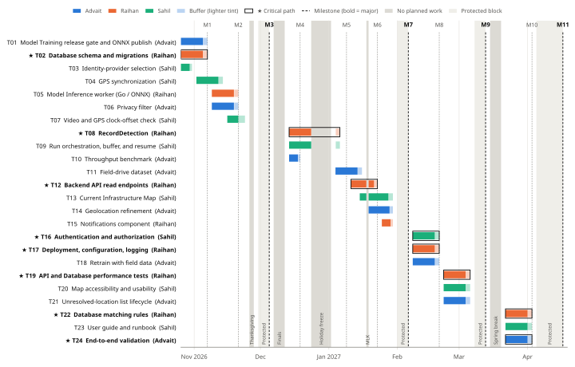

# StreetSmart: Task List, Milestones, Timeline, and Effort Matrix

**Project:** StreetSmart: Automated Public Infrastructure Damage Detection and Geospatial Reporting System
**Team Members:** Advait Vagerwal, Sahil Thakare, Raihan Rafeek
**Course:** CS 5001 – Computer Science Senior Design
**Advisor:** Eric Jamison
**Assignment:** Assignment 8 – Task Lists (Assignment #5) and Milestones, Timeline, and Effort Matrix (Assignment #6)
**Document Version:** 1.0
**Date:** October 28, 2026

---

# 0. How this plan was built

- **Source of tasks.** Every task names a module from the D0 block diagram or a D2 shared component, using the exact D0 to D2 names: Model Training, Trained Model Storage, Model Inference, Ingestion Pipeline, PostgreSQL/PostGIS Database, Backend API, Current Infrastructure Map, Authentication and authorization, Configuration and secrets, Structured logging and correlation, and Notifications. The open D2 peer-review action items (PR-01 to PR-12) are folded into the task that owns that module.
- **Design gaps are separate tasks.** Four gaps left open in D2 each get their own task with their own owner:
  - the identity-provider decision (T03),
  - the video and GPS clock-offset check (T07),
  - the Notifications component (T15),
  - the unresolved-location list lifecycle (T21).
- **Starting point.** Some work already exists: trained YOLO weights (best held-out mAP@0.5 0.82), the Go/Gin ONNX inference scaffold merged in PR #2 (Oct 13), and the Android capture app (video + GPS track) on the `android-capture-app` branch. Tasks start from these, not from zero.
- **Ownership rebalance.** Team Pulse (PR-10) found that Raihan owned most of the critical path. We made these changes:
  - Sahil now owns Authentication and authorization and the identity-provider decision.
  - Advait now owns the privacy filter, the throughput benchmark, the field-drive work, and the unresolved-location list.
  - Raihan keeps Model Inference, the Database, the Backend API, and deployment. He also takes Notifications, because it is a shared service like configuration and logging.
- **Estimates.** Each task has three estimates: optimistic (O), most likely (M), and pessimistic (P). The expected effort is E = (O + 4M + P) / 6 (Table 2). Hours count task work only. They leave out about 3 hours per person per week for team and advisor meetings, course reports, and code review.
- **Calendar.** Work days are Monday to Friday. We plan **no task work** during Thanksgiving (Nov 26–27), fall finals (Dec 7–11), the holiday freeze (Dec 24 – Jan 1), MLK Day (Jan 18), or spring break (Mar 15–19). All three members are on campus both semesters (no co-op rotations) and will work through winter break outside the holiday freeze.
- **Buffer.** Every task carries 17 to 20 percent buffer days at its end (Table 1, "Buffer" column). Each major milestone also has a **protected block**: a week with no planned task work, kept for integration and slip recovery.

---

# 1. Task List (Assignment #5)

There are 24 tasks, eight per member. Each takes one to two weeks of working time (5 to 10 working days). T08 and T09 pause for the holiday freeze. We have eight each rather than five for two reasons. The plan covers the rest of Fall, winter break, and all of Spring. And each open design gap from D2 is its own task. The same list is saved as `Tasklist.md` in the root of the team repository (`sahilt19/StreetSmart`).

Each task is one statement ending with its owner. The points under it give the module, the scope, and how we will know it is done.

**T01. Refine the Model Training workflow so the YOLO pothole detector passes the D0 release gate and is published for inference. Owner: Advait.**
- Module: Model Training, publishing to Trained Model Storage (interface I2).
- Start from the best existing weights (held-out mAP@0.5 0.82), not from scratch.
- Measure mAP@0.5 on the Cincinnati-free, leak-free held-out set. The D0 release gate is mAP@0.5 > 0.75.
- If the model falls short, tune the training settings or the dataset mix and retrain.
- Export the passing model to ONNX (opset 17, 1×3×640×640 input). Check that it loads with the expected input and output shapes.
- Publish it to Trained Model Storage with its manifest (model version, dataset version, class labels, input size, validation scores) and checksum.
- Done when: the ONNX model and manifest are in Trained Model Storage, and a second member reproduces the held-out score.

**T02. Develop the PostgreSQL/PostGIS Database schema on Supabase. Owner: Raihan.**
- Module: PostgreSQL/PostGIS Database.
- Create the four D1 tables as versioned migrations: `VIDEO_RUN`, `POTHOLE`, `DETECTION`, and `EVIDENCE_IMAGE`.
- Add the PostGIS location columns (WGS84, EPSG:4326) and the GiST spatial indexes from D1 §2.4.
- Add the `(video_run_id, frame_index)` unique constraint used by the duplicate check.
- Apply the peer-review schema decisions:
  - PR-05: whether `NEEDS_REVIEW` potholes can be match candidates.
  - PR-06: either remove `REPAIRED`, or document that it is set by hand during testing.
  - PR-11: a `last_frame_index` checkpoint column on `VIDEO_RUN`.
- Done when: the migrations run cleanly on an empty Supabase project and seed data loads.

**T03. Investigate and select the identity provider for the Authentication and authorization component. Owner: Sahil.**
- Module: Authentication and authorization (closes D2 §1.4 #9).
- Compare two or three options, for example Supabase Auth and Auth0. Compare free-tier limits, JWT support, Go and React libraries, and setup effort.
- Decide how city API keys (I10) are issued, stored (hashed), and rotated.
- Record the decision and the reasons in D2 §1.4 and the meeting notes.
- Why now: T16 builds authentication on this choice, and a late decision is risk R9.
- Done when: the team agrees on a provider at the weekly meeting and the decision is recorded.

**T04. Develop GPS synchronization in the Ingestion Pipeline. Owner: Sahil.**
- Module: Ingestion Pipeline (`GpsSynchronizer`, interface I5).
- Parse NMEA GPS tracks from the capture device, including fix quality.
- For each detection, interpolate between the two GPS fixes on either side of the frame time if both are valid and within 2 s. Otherwise, use the nearest valid fix within 2 s.
- If neither works, flag the detection `LOCATION_UNRESOLVED` and log it within 3 s (AC-01.2). Never send it to the database.
- Write unit tests with recorded tracks, including gaps and bad fixes.
- Done when: every detection in a test run has a coordinate or the unresolved flag.

**T05. Develop the Model Inference worker in Go with ONNX Runtime. Owner: Raihan.**
- Module: Model Inference (interfaces I3, I4, I6).
- Build on the Go/Gin scaffold merged in PR #2.
- Load the published ONNX model from Trained Model Storage and verify its checksum.
- Decode the video, sample frames at the configured rate, and resize them to 640×640.
- Decode the YOLO output into boxes and confidences, and apply non-maximum suppression.
- Keep detections at 0.70 or higher (`DetectionFilter`), one per frame (D2 §1.4 #6), and send them to the Ingestion Pipeline over I6.
- Done when: on the same 5-minute clip, the Go worker's detection count is within 5% of Python `infer.py`.

**T06. Develop the privacy filter in the Ingestion Pipeline. Owner: Advait.**
- Module: Ingestion Pipeline privacy step (US-04, NFR-PRIV-01, D0 Decision 5).
- Choose a pretrained face and license-plate detector, and check that its license allows project use.
- Blur every detected face and plate in the evidence crop before anything is uploaded.
- If redaction fails, retry once. If it still fails or is uncertain, withhold the image but keep the detection (E-15).
- Measure the miss rate on a labeled test set, and the added time per crop.
- Done when: no test crop with a visible face or plate reaches storage unblurred.

**T07. Develop the video and GPS clock-offset check in the Ingestion Pipeline. Owner: Sahil.**
- Module: Ingestion Pipeline (closes PR-03 and D2 §1.4 #3).
- The problem: frame times come from the camera clock. If that clock is wrong, for example set to local time instead of UTC, every detection in the run is placed in the wrong spot. The 2-second GPS rule in T04 does not catch this.
- For each run, check that the video's time range overlaps the GPS track's time range. If it does not, flag or reject the run before processing.
- Where possible, compare GPS-derived speed with motion in the video, to catch a smaller constant offset.
- Add the new edge case to the D2 edge-case register.
- Done when: a test run with a deliberately shifted clock is flagged before any detection is stored.

**T08. Develop `RecordDetection`, the write path into the PostgreSQL/PostGIS Database. Owner: Raihan.**
- Module: PostgreSQL/PostGIS Database (interface I7).
- Compute the weighted pothole confidence from D1 §3.1.
- Match each new detection to an existing pothole within 5 m (D1 §3.2). If there is no match, create a new pothole. If the match is ambiguous, create one marked `NEEDS_REVIEW`.
- Use an area lock and a single transaction, so two workers cannot create duplicate potholes for the same spot (D2 §1.4 #4).
- Reject repeats of the same `(video_run_id, frame_index)`.
- Done when: integration tests with repeated and concurrent submissions give the correct pothole and observation counts.

**T09. Develop run orchestration in the Ingestion Pipeline. Owner: Sahil.**
- Module: Ingestion Pipeline.
- Manage the `VIDEO_RUN` lifecycle (D2 Figure 2.2), from start to completed, failed, or cancelled.
- When the database is unreachable, buffer records on local disk and replay them when it returns (D0 I7).
- Resume a failed or cancelled run from its last committed frame. Name uploads `run_id/frame_index` so that re-uploads overwrite instead of duplicating (PR-11).
- Call `Notify` on failures. Until T15 is done, `Notify` writes a structured log entry, which D2 allows.
- Done when: stopping the database mid-run loses no records and creates no duplicates.

**T10. Test Model Inference throughput on the target hardware. Owner: Advait.**
- Modules: Model Inference and Ingestion Pipeline (closes PR-04; supports AC-01.1).
- Name the target machine and the ONNX execution provider (CUDA, DirectML, or CPU).
- Set the default frame sampling rate. D2 suggests 2 to 5 frames per second.
- Benchmark a 5-minute clip end to end. Time each stage: decode, inference, GPS matching, redaction, upload, and database write.
- Decide whether redaction and upload run at the same time as inference.
- Done when: a per-stage time budget is committed, showing whether 60 minutes of video can be processed in 20.

**T11. Obtain a field-drive dataset from Cincinnati roads with known pothole locations. Owner: Advait.**
- Inputs to the Ingestion Pipeline: I4 (video) and I5 (GPS), recorded with the Android capture app.
- Drive at least two routes, each in both directions, so offset and matching can be tested from both sides.
- Hand-survey the coordinates of the potholes on those routes, to use as ground truth.
- This needs a borrowed vehicle and at least two members (a driver and an operator). It depends on the weather (risk R7).
- Done when: the recordings and the ground-truth file are stored and documented.

**T12. Develop the Backend API read endpoints in Gin. Owner: Raihan.**
- Module: Backend API (interfaces I8, I9, I10).
- `GET /api/v1/potholes`: potholes inside a bounding box, capped at 500.
- `GET /api/v1/potholes/{id}`: one pothole with its detections and evidence images.
- `GET /api/v1/export/geojson`: an RFC 7946 GeoJSON export for city GIS systems.
- Validate spatial parameters before touching the database (`SpatialQueryValidator`), and return RFC 7807 errors.
- Drop the POST detections and PATCH runs endpoints from the prototype (PR-12).
- Route every handler through an auth middleware interface, so T16 can plug in later.
- Done when: responses pass an RFC 7946 validator and bad bounding boxes return 400.

**T13. Develop the Current Infrastructure Map in React. Owner: Sahil.**
- Module: Current Infrastructure Map (interface I9).
- Show potholes for the current map view, querying the API by bounding box as the user pans and zooms.
- Cluster pins when zoomed out.
- Filter by confidence and status (D2 §2.7).
- Open a record panel with confidence, observation count, dates, and the redacted evidence image.
- Ignore stale responses when the user moves quickly.
- Start against mock data and switch to the real API when T12 finishes.
- Done when: potholes from the database appear in the browser and filter correctly.

**T14. Refine geolocation in the Ingestion Pipeline using the field-drive data. Owner: Advait.**
- Module: Ingestion Pipeline (closes PR-02 and PR-07).
- Measure how far the recorded GPS position is from the surveyed pothole location. A forward-facing camera sees a pothole several to 15+ m ahead of the vehicle.
- Measure how far apart repeat sightings of the same pothole land.
- Project each location forward along the GPS heading, using the box position and the camera geometry.
- Set the matching thresholds (D1's 2.0 m and 1.5 m rule) from the measured spread, and record them in D2 §1.4 #5.
- Done when: the median error against the surveyed coordinates is reported and the thresholds are fixed.

**T15. Develop the Notifications component. Owner: Raihan.**
- Module: Notifications (closes PR-01; edge cases E-46 to E-49).
- Write the D2 section first: event schema, behavior, interface, and errors, in the same format as D2 §2.10 to §2.12.
- Implement `Notify(event NotificationEvent) error`.
- Suppress duplicate alerts with a dedup key, and route alerts by severity.
- Deliver to a log entry and one chat or email channel, with a bounded retry.
- Done when: a failed run in testing produces exactly one alert.

**T16. Develop Authentication and authorization for the map and the city export. Owner: Sahil.**
- Module: Authentication and authorization (NFR-SEC-01).
- Use the identity provider chosen in T03.
- Add login to the map, and verify the JWT on every protected request (I9).
- Issue API keys for city systems (I10), store them hashed, and support revoking them.
- Enforce the `viewer` and `exporter` roles. Return 401 when there is no credential and 403 when the role is wrong.
- Done when: the negative tests pass on the staging deployment.

**T17. Develop the deployment of the Backend API and the Model Inference worker. Owner: Raihan.**
- Modules: Backend API, Model Inference, Configuration and secrets, and Structured logging and correlation.
- Build Docker images for the API and the inference worker.
- Set up GitHub Actions CI to run the tests and build the images on every pull request.
- Load configuration and secrets from environment variables, never from Git (D2 §2.11).
- Add structured logs with a correlation ID for each request and each run (D2 §2.12).
- Done when: a merge to main deploys to staging, and a run's logs can be found by its ID.

**T18. Refine the Model Training dataset with frames from the field drive, then retrain. Owner: Advait.**
- Module: Model Training, publishing to Trained Model Storage.
- Add the potholes the model missed, and its false positives (hard negatives), from the T11 field drive to the training data.
- Retrain and re-evaluate on the same held-out set.
- Publish the new model only if it still passes the release gate. Otherwise, keep the stable model (D2 §2.3).
- Done when: either a better model is published, or the reason for keeping the old one is recorded.

**T19. Test the performance of the Backend API and the PostgreSQL/PostGIS Database. Owner: Raihan.**
- Modules: Backend API and PostgreSQL/PostGIS Database.
- AC-02.1: export 500 records in under 5 s.
- AC-02.2: reject invalid spatial input in under 1 s.
- NFR-PERF-01: answer map viewport queries in under 2 s.
- Load-test several inference workers writing at once (D2 §1.4 #4).
- Log every failure as a GitHub Issue with an owner.
- Done when: the results are in the test report, with pass or fail for each target.

**T20. Validate the Current Infrastructure Map for accessibility and usability. Owner: Sahil.**
- Module: Current Infrastructure Map (NFR-ACC-01).
- Audit against WCAG 2.1 AA with an automated tool (for example axe), plus keyboard-only and screen-reader checks.
- Make sure status is never shown by color alone.
- Run a usability walkthrough with our advisor and, if possible, a municipal stakeholder.
- Done when: findings and fixes are documented, and no blocking accessibility issue remains open.

**T21. Develop the lifecycle of the unresolved-location list in the Ingestion Pipeline. Owner: Advait.**
- Module: Ingestion Pipeline (closes PR-09).
- The problem: detections with no usable GPS fix are kept on a local list, but D2 never says what happens to them next.
- Decide whether to reprocess them (for example, after the T14 geolocation changes) or export them in the run summary for manual review.
- Set how long items are kept and a size limit, and define what happens when the list is full.
- Keep metadata only, never the image (NFR-PRIV-01).
- Add the full-list edge case to the D2 edge-case register.
- Done when: a test run that overfills the list behaves as documented.

**T22. Refine the PostgreSQL/PostGIS Database matching rules with the field and load-test results. Owner: Raihan.**
- Module: PostgreSQL/PostGIS Database.
- Apply the thresholds fixed in T14 to `RecordDetection`.
- Attach ambiguous detections to an existing nearby `NEEDS_REVIEW` pothole, instead of creating a new one each time (PR-05).
- Fix any locking or indexing problems found in T19.
- Done when: re-running the field-drive data creates no duplicate `NEEDS_REVIEW` potholes.

**T23. Document the user guide and the operator runbook. Owner: Sahil.**
- Modules: Current Infrastructure Map and Ingestion Pipeline.
- User guide: using the map, its filters, and the record panel.
- Runbook: submitting a video run, issuing and rotating API keys, recovering a failed run, and reading the logs.
- Done when: a member who did not write the runbook can follow it on a fresh machine.

**T24. Validate the end-to-end system against the Must requirements on a 60-minute recorded drive. Owner: Advait.**
- Scope: Model Inference through the Current Infrastructure Map.
- Requirements checked: AC-01.1, AC-01.2, AC-02.1, AC-02.2, US-04, NFR-PRIV-01, and NFR-REL-01.
- For each requirement, record pass, fail, or an accepted gap with its reason.
- Publish the test report. It also feeds the final course report (C14).
- Done when: the other two members and the advisor have reviewed the report.

---

# 2. Milestones List (Assignment #6)

A milestone is a dated outcome we can check, not a task. `✅` marks completed items. "Verified by" names the person who checks the outcome. For planned milestones, that person is never the member who did the work.

## 2.1 Completed course deliverables and baseline

| ID  | Milestone                                         | Date                   | What it demonstrates                                                                                              | How it is verified                                               | Verified by                              | Status     |
| --- | ------------------------------------------------- | ---------------------- | ----------------------------------------------------------------------------------------------------------------- | ---------------------------------------------------------------- | ---------------------------------------- | ---------- |
| C1 | Topic statement, team bios, and reflective essays | Week 2, ~Sep 4, 2026 | The StreetSmart project topic, a short bio for each member, and each member's individual reflective essay | Submitted and graded | Instructor | ✅ Complete |
| C2 | Team Formation and Project Description (Assignment 2) | Sep 9, 2026 | Team StreetSmart formed, with our row in the shared Fall 2026 Senior Design Team Table (team name, members and majors, topic area). The team repository, `sahilt19/StreetSmart` (created Sep 2), holds `Project-Description.md` with the team name, members' majors and UC emails, and the topic area "Using Computer Vision to solve civic issues for the City of Cincinnati", plus a `bios/` folder for the Assignment 1 professional bios | Spreadsheet row filled in; the same entries submitted as text on Canvas and graded | Instructor | ✅ Complete |
| C3 | Advisor selection and Constraints Essay           | Week 3, ~Sep 11, 2026 | Eric Jamison confirmed as advisor. The economic, security, ethical, and professional constraints that shape the design | Submitted and graded                                         | Instructor                               | ✅ Complete |
| C4 | Team Contract                                     | Sep 17, 2026           | Agreed roles, communication, decision-making, and conflict-resolution rules                                       | Signed by all three members; submitted and graded                | Instructor                               | ✅ Complete |
| C5 | User Stories and Use Cases (Assignment 4)         | ~Sep 25, 2026         | US-01 to US-05, UC-01 and UC-02, and AC-01.1 to AC-02.2 with an INVEST check                                      | Submitted and graded                                             | Instructor                               | ✅ Complete |
| C6 | D0 High-Level Design                              | ~Oct 2, 2026          | Seven components, interfaces I1 to I10, the data-flow diagram, and five architecture decisions                    | Submitted and graded                                             | Instructor, advisor                      | ✅ Complete |
| C7 | D1 Detailed Design                                | Oct 8, 2026            | ERD, the weighted-confidence and spatial-matching algorithms, the API contract, and technology choices            | Submitted and graded                                             | Instructor, advisor                      | ✅ Complete |
| C8 | Baseline prototype artifacts                      | Oct 13, 2026           | Trained YOLO weights (held-out mAP@0.5 0.82), the Go/Gin ONNX inference scaffold, and the Android capture app   | PR #2 merged after one-member review; held-out scores in `runs/` | Raihan (reviewed PR #2), Advait (scores) | ✅ Complete |
| C9 | D2 Detailed Design and peer review (Assignment 7) | Oct 14, 2026           | Data model, behavior, interfaces, and errors for every component; edge-case register; 12 peer-review action items | Draft 1.4 submitted; reviewed by Teams Znerv and Pulse           | Instructor, peer teams                   | ✅ Complete |
| C10 | Requirements traceability matrix (Week 9)         | Week 9, ~Oct 23, 2026 | Each requirement traced to design elements, and each component traced back to a requirement                       | D2 §4.1 and §4.2                                                 | Instructor                               | ✅ Complete |

## 2.2 Remaining course deliverables

| ID  | Milestone                                                          | Date                  | What it demonstrates                                                  | How it is verified                                            | Verified by         | Status                                            |
| --- | ------------------------------------------------------------------ | --------------------- | --------------------------------------------------------------------- | ------------------------------------------------------------- | ------------------- | ------------------------------------------------- |
| C11 | Task List, Milestones, Timeline, and Effort Matrix (this document) | Wed Oct 28, 2026      | A plan with owners, dates, buffer, and risks, built from the design   | PDF submitted; `Tasklist.md` committed to the repository root | Instructor, advisor | Planned                                           |
| C12 | Oral design presentation | Week 13 or 14: Wed Nov 18 or Wed Nov 25, 2026 | The team explains and defends the problem, the D0 to D2 design, and this plan out loud, and shows progress so far: M1, plus M2 for a Week 14 slot | Delivered in class and graded (15% of the course grade) | Instructor | Planned (the instructor assigns the slot) |
| C13 | Design report, design notebook, and team assessment (the Week 14 report) | Week 14, Wed Nov 25, 2026 | The full fall design in one report, with progress against Tables 1 and 2: M1 and M2 reached, T01 to T07 status. Each member's dated design notebook. The team's assessment of each member's contribution. | Submitted and graded (15% of the course grade). The report reproduces Tables 1 and 2 with actual dates and hours. Table 2 is the record the syllabus names for adjusting individual grades. | Instructor, advisor | Planned |
| C14 | CS 5002 final report, demonstration, and showcase                  | Apr 19–23, 2027       | The finished prototype and its test results                           | Live demo plus the T24 test report                            | Instructor, advisor | Planned (dates to be set by the CS 5002 calendar) |

C12 and C13 come from the Week 1 course roadmap and grading table. The roadmap puts oral presentations in Weeks 13 and 14, and the semester wrap-up in Week 14. Weeks 10 to 12 (test and validation planning, ethics and responsible use, technical communication) are lecture topics with no separate graded deliverable, so they have no milestone. The grading table has no separate progress report, so the Week 14 report that reproduces Tables 1 and 2 is the design report (C13). Work on C12 and C13 comes out of the 3 hours per person per week reserved for course reports (§0), so it is not in Table 2.

## 2.3 Internal milestones (every one to three weeks)

Major milestones are in **bold** and have a protected block before them.

| ID      | Milestone                   | Date                 | What it demonstrates                                                                                                                                 | How it is verified                                                                                                                                                                    | Verified by                                                |
| ------- | --------------------------- | -------------------- | ---------------------------------------------------------------------------------------------------------------------------------------------------- | ------------------------------------------------------------------------------------------------------------------------------------------------------------------------------------- | ---------------------------------------------------------- |
| M1      | Foundations ready           | Fri Nov 6, 2026      | A release-gated ONNX model is in Trained Model Storage. The Database schema is migrated on Supabase. The identity provider is chosen.                | Reviewer re-runs the held-out evaluation (mAP@0.5 > 0.75) and checks the manifest checksum. Migrations run cleanly on an empty Supabase project. The provider decision is in D2 §1.4. | Sahil (model), Advait (schema), Raihan (provider decision) |
| M2      | Detections are geotagged    | Fri Nov 20, 2026     | The Go Model Inference worker sends detections at 0.70 or higher over I6. GPS synchronization gives each one a coordinate or `LOCATION_UNRESOLVED`.  | On a 5-minute clip, the Go detection count matches Python `infer.py` within 5%. Every detection has a location or a flag.                                                             | Advait                                                     |
| **M3**  | **Fall vertical slice**     | **Fri Dec 4, 2026**  | One recorded drive becomes blurred evidence crops and geotagged detections stored in Supabase. A run with a shifted camera clock is flagged.         | Live demo at the advisor meeting. No unblurred image exists in the storage bucket.                                                                                                    | Eric Jamison (advisor)                                     |
| M4      | Throughput budget published | Fri Dec 18, 2026     | Target hardware and sampling rate are named. A per-stage time budget shows whether AC-01.1 (60 minutes of video in 20) is reachable.                 | Benchmark script and results committed. Reviewer re-runs it on the same clip.                                                                                                         | Raihan                                                     |
| M5      | Ingestion complete          | Fri Jan 8, 2027      | `RecordDetection` merges repeat sightings. The local buffer survives a database outage. A cancelled run resumes from its checkpoint.                 | Integration test stops the database mid-run, then checks for no lost and no duplicate `DETECTION` rows.                                                                               | Advait                                                     |
| M6      | API serves real data        | Fri Jan 22, 2027     | Bounding-box query, pothole detail, and GeoJSON export return real Supabase data.                                                                    | Responses pass an RFC 7946 validator. Invalid bounding boxes return RFC 7807 400 errors.                                                                                              | Sahil                                                      |
| **M7**  | **Alpha: video to map**     | **Fri Feb 5, 2027**  | Field-drive video and GPS go in, and potholes appear on the Current Infrastructure Map in a browser. A failed run sends one operator alert.          | Live demo on T11 field data at the advisor meeting.                                                                                                                                   | Eric Jamison (advisor)                                     |
| M8      | Secured staging deployment  | Fri Feb 19, 2027     | CI builds and deploys Docker images. Map login uses JWT and export uses an API key. The retrained model passes the release gate.                     | Negative tests: a missing token returns 401, the wrong role returns 403, and a revoked key is rejected. CI shows a green run.                                                         | Advait (authentication, CI), Sahil (retrained model) |
| **M9**  | **Beta: feature complete**  | **Fri Mar 12, 2027** | AC-02.1, AC-02.2, and NFR-PERF-01 measured. Accessibility audit done. Geolocation thresholds locked. Unresolved-location list behaves as documented. | Test report reviewed at the advisor meeting. Failures are logged as GitHub Issues with owners.                                                                                        | Eric Jamison (advisor)                                     |
| M10     | Release candidate           | Fri Apr 2, 2027      | End-to-end validation against every Must requirement. User guide and runbook done. Database matching rules final.                                    | T24 report: each requirement passes or has a documented, accepted gap.                                                                                                                | All three members, cross-checked                           |
| **M11** | **Final system frozen**     | **Fri Apr 16, 2027** | The tagged release is demo-ready and documented.                                                                                                     | Clean install from the runbook on a fresh machine. Advisor sign-off.                                                                                                                  | Eric Jamison (advisor)                                     |

The gap from M3 (Dec 4) to M4 (Dec 18) includes fall finals week, which has no planned work. The gap from M9 (Mar 12) to M10 (Apr 2) includes spring break.

---

# 3. Table 1: Timeline (Assignment #6)

**Columns.** "Work ends" is the planned finish without buffer; "(noon)" marks a half-day, so the buffer starts that afternoon. "Buffer" is the slack days at the end of the task and their share of its duration. "Finish" is the committed completion date. **★** marks the critical path. "Risks" links to the register in §6. All dates are 2026 for Oct to Dec and 2027 for Jan to Apr.

**Critical path:** T02 → T08 → T12 → T16 and T17 → T19 → T22 and T24 → M10 → M11. It is the longest chain of dependent tasks, at 59 working days with buffers. Two pairs tie: T16 and T17 both run Feb 8–19 and both gate T19, and T22 and T24 both run Mar 22 – Apr 2 and both gate M10, so a slip in any of the four moves M11. From T16 and T17 onward, the only slack is the task buffers and the protected blocks before M9 and M11. Earlier on the path there are three gaps, and all three are real float:
- **T02 → T08: 13 working days (Nov 9–25).** T08 waits for Raihan, who owns both tasks, to finish T05 on Nov 20. Thanksgiving, the protected block before M3, and finals follow. T02 could finish as late as Nov 25 without moving T08, but any slip past Nov 6 still misses M1.
- **T08 → T12: 3 working days (Jan 6–8).** These days hold the M5 integration test, which checks `RecordDetection` before T12 builds on it. T08 could finish as late as Jan 8 without moving T12.
- **T12 → T16 and T17: 5 working days (Jan 25–29).** Neither can start earlier: Sahil (T16) is on T13 and Raihan (T17) is on T15 until Jan 29, and Feb 1–5 is the protected block before M7. T12 could finish as late as Jan 29 without moving T16 or T17, but any slip past Jan 22 misses M6 and leaves T13 less time on the real API.

The geolocation chain (T04 → T07 → T09 → T14, with T11) finishes on Jan 29, about seven weeks before T24 needs it. We keep that float on purpose, so there is time for a second field drive if R1 or R7 is triggered.

| ID | Task (short form; full statement in §1) | Owner | Start | Work ends | Buffer | Finish | Depends on | CP | Risks |
|---|---|---|---|---|---|---|---|---|---|
| T01 | Refine Model Training to pass the release gate and publish the ONNX model | Advait | Oct 26 | Nov 4 | 2 d (20%) | Nov 6 | — | | R4 |
| T02 | Develop the PostgreSQL/PostGIS Database schema on Supabase | Raihan | Oct 26 | Nov 4 | 2 d (20%) | Nov 6 | — | ★ | R5, R8 |
| T03 | Investigate and select the identity provider | Sahil | Oct 26 | Oct 29 | 1 d (20%) | Oct 30 | — | | R9 |
| **M1** | **Foundations ready** | | | | | **Nov 6** | T01, T02, T03 | | |
| T04 | Develop GPS synchronization in the Ingestion Pipeline | Sahil | Nov 2 | Nov 11 | 2 d (20%) | Nov 13 | — | | R1 |
| T05 | Develop the Model Inference worker in Go / ONNX Runtime | Raihan | Nov 9 | Nov 18 | 2 d (20%) | Nov 20 | T01 | | R2, R10 |
| T06 | Develop the privacy filter in the Ingestion Pipeline | Advait | Nov 9 | Nov 18 | 2 d (20%) | Nov 20 | T01 | | R3 |
| T07 | Develop the video and GPS clock-offset check | Sahil | Nov 16 | Nov 20 | 1 d (17%) | Nov 23 | T04 | | R1 |
| **M2** | **Detections are geotagged** | | | | | **Nov 20** | T04, T05 | | |
| **C12** | **Oral design presentation (Week 13 or 14; slot set by the instructor)** | | | | | **Nov 18 or Nov 25** | M1 (and M2 for a Week 14 slot) | | |
| **C13** | **Design report, design notebook, and team assessment (Week 14 report)** | | | | | **Nov 25** | M1, M2 | | |
| — | Thanksgiving (no planned work) | All | Nov 26 | | | Nov 27 | | | R6 |
| — | **Protected block before M3** (integration, slip recovery) | All | Nov 30 | | 5 d | Dec 4 | | | |
| **M3** | **Fall vertical slice** | | | | | **Dec 4** | T04, T05, T06, T07 | | |
| — | Fall finals (no planned work) | All | Dec 7 | | | Dec 11 | | | R6 |
| T08 | Develop `RecordDetection` (confidence, matching, lock, duplicate check) | Raihan | Dec 14 | Dec 23 | 2 d (20%) | Jan 5 | T02 | ★ | R5 |
| T09 | Develop run orchestration in the Ingestion Pipeline | Sahil | Dec 14 | Dec 23 | 2 d (20%) | Jan 5 | T02, T04, T07 | | |
| T10 | Test Model Inference throughput and publish the time budget | Advait | Dec 14 | Dec 17 | 1 d (20%) | Dec 18 | T05, T06 | | R2 |
| **M4** | **Throughput budget published** | | | | | **Dec 18** | T10 | | |
| — | Holiday freeze (no planned work) | All | Dec 24 | | | Jan 1 | | | R6 |
| **M5** | **Ingestion complete** | | | | | **Jan 8** | T08, T09 | | |
| T11 | Obtain the field-drive dataset with surveyed pothole locations | Advait | Jan 4 | Jan 13 | 2 d (20%) | Jan 15 | — | | R7, R1 |
| T12 | Develop the Backend API read endpoints | Raihan | Jan 11 | Jan 21 (noon) | 1.5 d (17%) | Jan 22 | T08 | ★ | R5 |
| T13 | Develop the Current Infrastructure Map in React | Sahil | Jan 15 | Jan 27 | 2 d (20%) | Jan 29 | T12 (mock data until T12 finishes) | | |
| T14 | Refine geolocation using the field-drive data | Advait | Jan 19 | Jan 28 (noon) | 1.5 d (17%) | Jan 29 | T09, T11 | | R1 |
| T15 | Develop the Notifications component | Raihan | Jan 25 | Jan 28 | 1 d (20%) | Jan 29 | T09 | | |
| **M6** | **API serves real data** | | | | | **Jan 22** | T12 | | |
| — | **Protected block before M7** | All | Feb 1 | | 5 d | Feb 5 | | | |
| **M7** | **Alpha: video to map** | | | | | **Feb 5** | T11, T13, T14, T15 | | |
| T16 | Develop Authentication and authorization (JWT, API keys, roles) | Sahil | Feb 8 | Feb 17 | 2 d (20%) | Feb 19 | T03, T12 | ★ | R9 |
| T17 | Develop the deployment (Docker, CI, configuration, logging) | Raihan | Feb 8 | Feb 17 | 2 d (20%) | Feb 19 | T12 | ★ | R8 |
| T18 | Refine the training dataset with field-drive frames and retrain | Advait | Feb 8 | Feb 17 | 2 d (20%) | Feb 19 | T11 | | R4 |
| **M8** | **Secured staging deployment** | | | | | **Feb 19** | T16, T17, T18 | | |
| T19 | Test Backend API and Database performance and concurrent load | Raihan | Feb 22 | Mar 3 | 2 d (20%) | Mar 5 | T16, T17 | ★ | R5 |
| T20 | Validate the Map for WCAG 2.1 AA and usability | Sahil | Feb 22 | Mar 3 | 2 d (20%) | Mar 5 | T13, T16 | | R11 |
| T21 | Develop the unresolved-location list lifecycle | Advait | Feb 22 | Mar 3 | 2 d (20%) | Mar 5 | T09, T14 | | |
| — | **Protected block before M9** | All | Mar 8 | | 5 d | Mar 12 | | | |
| **M9** | **Beta: feature complete** | | | | | **Mar 12** | T14, T18, T19, T20, T21 | | |
| — | Spring break (no planned work) | All | Mar 15 | | | Mar 19 | | | R6 |
| T22 | Refine the Database matching rules with field and load-test results | Raihan | Mar 22 | Mar 31 | 2 d (20%) | Apr 2 | T14, T19 | ★ | |
| T23 | Document the user guide and operator runbook | Sahil | Mar 22 | Mar 31 | 2 d (20%) | Apr 2 | T16, T17 | | |
| T24 | Validate the end-to-end system against the Must requirements | Advait | Mar 22 | Mar 31 | 2 d (20%) | Apr 2 | T14, T18, T19, T21 | ★ | R1, R2, R3 |
| **M10** | **Release candidate** | | | | | **Apr 2** | T22, T23, T24 | | |
| — | **Protected block before M11** (two weeks: defect fixes only) | All | Apr 5 | | 10 d | Apr 16 | | | |
| **M11** | **Final system frozen** | | | | | **Apr 16** | M10 | ★ | |
| **C14** | **CS 5002 final report and showcase** | | | | | **Apr 19–23** | M11 | | |



**Figure 1. Gantt view of Table 1.** Bars are colored by owner, and the lighter end of each bar is its buffer. Outlined bars (★) are the critical path. Dashed lines are milestones, bold for the major ones. Gray bands are the no-work windows and the protected blocks. The figure is drawn from Table 1 by `Design_Diagrams/plan_gantt.py`, so it changes only when the table does.

**How the main risks show up in the timeline.**
- **R1 (geolocation accuracy).** The clock-offset check (T07) is in place before the fall demo. We collect real drive data (T11) before classes start, and leave six weeks between T14 and M9. That gap leaves time for a second drive if the first data is poor.
- **R2 (throughput).** We benchmark in December (T10), before the API and map are built on top of the pipeline.
- **R6 (academic calendar).** Thanksgiving, finals, the holiday freeze, and spring break appear as rows with no planned work.
- **R7 (winter weather).** T11 has a two-day buffer and finishes on Jan 15, three weeks before Alpha (M7) needs its data.
- **R9 (identity provider).** The decision (T03) is due Oct 30, more than three months before T16 builds on it.

---

# 4. Table 2: Effort Matrix (Assignment #6)

Hours are expected task effort from three-point estimates: E = (O + 4M + P) / 6, rounded to whole hours. **Bold** marks the member with primary responsibility. That member carries the largest share of every row. Other members' hours cover pairing, interface work, review, and test support. For example, T11 needs a driver and an operator, so all three members drive.

| ID | Task (short) | O / M / P | E (h) | Advait | Raihan | Sahil | Row total |
|---|---|---|---|---|---|---|---|
| T01 | Model Training release gate and ONNX publish | 14 / 20 / 32 | 21 | **18** | 3 | 0 | 21 |
| T02 | Database schema and migrations | 10 / 14 / 22 | 15 | 0 | **12** | 2 | 14 |
| T03 | Identity-provider selection | 4 / 6 / 10 | 6 | 1 | 1 | **5** | 7 |
| T04 | GPS synchronization | 12 / 16 / 24 | 17 | 2 | 2 | **13** | 17 |
| T05 | Model Inference worker (Go / ONNX) | 16 / 22 / 34 | 23 | 6 | **17** | 0 | 23 |
| T06 | Privacy filter | 16 / 24 / 36 | 25 | **20** | 2 | 2 | 24 |
| T07 | Video and GPS clock-offset check | 6 / 10 / 16 | 10 | 2 | 0 | **8** | 10 |
| T08 | `RecordDetection` | 18 / 24 / 36 | 25 | 2 | **20** | 2 | 24 |
| T09 | Run orchestration, buffer, and resume | 14 / 20 / 30 | 21 | 0 | 5 | **16** | 21 |
| T10 | Throughput benchmark | 6 / 10 / 16 | 10 | **7** | 3 | 0 | 10 |
| T11 | Field-drive dataset | 10 / 16 / 28 | 17 | **10** | 3 | 3 | 16 |
| T12 | Backend API read endpoints | 14 / 20 / 28 | 20 | 2 | **15** | 3 | 20 |
| T13 | Current Infrastructure Map | 18 / 26 / 38 | 27 | 0 | 4 | **23** | 27 |
| T14 | Geolocation refinement | 12 / 18 / 28 | 19 | **13** | 0 | 6 | 19 |
| T15 | Notifications component | 6 / 10 / 16 | 10 | 0 | **8** | 3 | 11 |
| T16 | Authentication and authorization | 12 / 18 / 26 | 18 | 0 | 5 | **14** | 19 |
| T17 | Deployment, configuration, logging | 10 / 14 / 22 | 15 | 1 | **12** | 1 | 14 |
| T18 | Retrain with field data | 8 / 14 / 24 | 15 | **13** | 1 | 0 | 14 |
| T19 | API and Database performance tests | 10 / 14 / 20 | 14 | 5 | **9** | 0 | 14 |
| T20 | Map accessibility and usability | 8 / 12 / 18 | 12 | 3 | 0 | **9** | 12 |
| T21 | Unresolved-location list lifecycle | 8 / 12 / 18 | 12 | **10** | 0 | 2 | 12 |
| T22 | Database matching rules | 8 / 12 / 18 | 12 | 2 | **10** | 0 | 12 |
| T23 | User guide and runbook | 8 / 12 / 16 | 12 | 2 | 2 | **8** | 12 |
| T24 | End-to-end validation | 12 / 18 / 28 | 19 | **9** | 5 | 5 | 19 |
| | **Column total (h)** | | | **128** | **139** | **125** | **392** |
| | **Share of total** | | | 32.7% | 35.5% | 31.9% | 100% |
| | **Tasks as primary** | | | 8 | 8 | 8 | 24 |

Row totals can differ from E by one hour because each member's share is rounded separately.

**Imbalance and rebalancing plan.** The columns are very close but not completely even. Raihan carries 139 h. That is 14 h more than Sahil's 125 h, and 11 h more than Advait's 128 h. Raihan also owns six of the eight critical-path tasks (T02, T08, T12, T17, T19, T22). This is what is left of the PR-10 concern after the rebalance. Our plan:

1. **Shift review and test work away from Raihan.** Advait writes the T19 load-test scripts (about 5 h) and reviews every T08 and T12 pull request. These moves are already in the table. If the gap is still above 10% at the checkpoint below, Sahil also takes the GitHub Actions workflow in T17 (about 4 h).
2. **Track actual hours.** Each member logs hours on their GitHub Issues. At M6 (Jan 22) and M9 (Mar 12), we compare the actual column totals to this table. If any member is more than 10% above the team mean, we move that member's next non-critical task to the lowest-loaded member. For example, T22 could move from Raihan to Advait. We record the change in a revised Table 2 and in the meeting notes.
3. **Keep a backup on the critical path.** Every critical-path task has a named second member: Sahil for T02, T12, T17, and T24; Advait for T08, T19, and T22; and Raihan for T16. That person reviews its pull requests and can take it over if the owner is blocked (R5).

---

# 5. Work Breakdown Structure

Three levels: phase, then the D0/D2 module, then the Task List items.

```
StreetSmart implementation (Oct 26, 2026 – Apr 16, 2027)
│
├── 1. Design closeout and foundations (Fall Weeks 10–11)
│   ├── 1.1 Model Training / Trained Model Storage ...... T01 (Advait)
│   ├── 1.2 PostgreSQL/PostGIS Database ................. T02 (Raihan)
│   └── 1.3 Authentication and authorization ............ T03 (Sahil)
│
├── 2. Core pipeline (Fall Weeks 11–15, winter break)
│   ├── 2.1 Model Inference ............................. T05 (Raihan), T10 (Advait)
│   ├── 2.2 Ingestion Pipeline .......................... T04 (Sahil), T06 (Advait),
│   │                                                     T07 (Sahil), T09 (Sahil)
│   └── 2.3 PostgreSQL/PostGIS Database ................. T08 (Raihan)
│
├── 3. Application and field data (Spring Weeks 1–6)
│   ├── 3.1 Field data and geolocation .................. T11 (Advait), T14 (Advait)
│   ├── 3.2 Backend API ................................. T12 (Raihan)
│   ├── 3.3 Current Infrastructure Map .................. T13 (Sahil)
│   ├── 3.4 Notifications ............................... T15 (Raihan)
│   ├── 3.5 Authentication and authorization ............ T16 (Sahil)
│   ├── 3.6 Deployment, Configuration and secrets,
│   │       Structured logging and correlation .......... T17 (Raihan)
│   └── 3.7 Model Training (retrain) .................... T18 (Advait)
│
└── 4. Verification and delivery (Spring Weeks 7–14)
    ├── 4.1 Performance and load testing ................ T19 (Raihan)
    ├── 4.2 Accessibility and usability ................. T20 (Sahil)
    ├── 4.3 Ingestion Pipeline (unresolved list) ........ T21 (Advait)
    ├── 4.4 PostgreSQL/PostGIS Database refinement ...... T22 (Raihan)
    ├── 4.5 Documentation ............................... T23 (Sahil)
    └── 4.6 End-to-end system validation ................ T24 (Advait)
```

---

# 6. Risk Register

Likelihood (L) and impact (I) are rated Low, Medium, or High. "Trigger" is the observable signal that the risk is happening and the mitigation should start.

| ID  | Category  | Risk                                                                                                                                                                                                      | L      | I      | Strategy | Mitigation (where it shows in Table 1)                                                                                                                                                         | Owner  | Trigger                                                                                                        |
| --- | --------- | --------------------------------------------------------------------------------------------------------------------------------------------------------------------------------------------------------- | ------ | ------ | -------- | ---------------------------------------------------------------------------------------------------------------------------------------------------------------------------------------------- | ------ | -------------------------------------------------------------------------------------------------------------- |
| R1  | Technical | The geotag records the vehicle's position, not the pothole's. GPS error, timing error, and camera-clock offset push locations past the 5 m match radius and AC-01.1's 5 m accuracy (PR-02, PR-03, PR-07). | High   | High   | Reduce   | Clock-offset check before the fall demo (T07). Real drive data early (T11, Jan 4). Forward projection and measured thresholds (T14). Six weeks of slack between T14 and M9 for a second drive. | Advait | Median spread of repeat sightings of one pothole in T11 data is above 5 m.                                     |
| R2  | Technical | AC-01.1 (60 minutes of video in 20) cannot be met on available hardware once redaction, upload, and database writes are included (PR-04).                                                                 | Medium | High   | Reduce   | Benchmark in December (T10, M4), before later work depends on it. Fallbacks: lower sampling rate, run redaction and upload concurrently, run inference on the GPU training machine.            | Advait | T10 projects more than 1,200 s for 60 minutes of video.                                                        |
| R3  | Technical | The redaction model misses faces or plates, or is too slow, which risks US-04 and NFR-PRIV-01.                                                                                                            | Medium | High   | Avoid    | Block by default: withhold the image whenever redaction fails or is unsure (E-15). The detection is still kept. Measured in T06 and re-checked in T24.                                         | Advait | Redaction misses more than 5% of plates or faces on the T06 test set, or adds more than 30% to per-frame time. |
| R4  | Technical | The detector does not pass the mAP@0.5 > 0.75 release gate on the Cincinnati-free held-out set, or field footage lowers recall.                                                                           | Medium | Medium | Reduce   | T01 starts from the best existing weights. T18 retrains with field hard negatives. A failed model never replaces the stable one (D2 §2.3).                                                     | Advait | T01 ends with held-out mAP@0.5 below 0.75.                                                                     |
| R5  | Team      | The critical path depends heavily on one member (Raihan: T02, T08, T12, T17, T19, T22). Illness or overload stalls the project (PR-10).                                                                             | Medium | High   | Reduce   | Ownership already rebalanced (§0). Each critical-path task has a named backup member (§4, item 3). Actual hours compared at M6 and M9.                                                                   | Sahil  | A critical-path task uses all of its buffer, or a member is more than 10% above the team-mean hours.           |
| R6  | Team      | The academic calendar cuts capacity: Thanksgiving, finals, the holiday freeze, spring break, and midterms.                                                                                                | High   | Medium | Avoid    | No planned work in those windows (rows in Table 1). Protected blocks before M3, M7, M9, and M11. All members are on campus both semesters, with no co-op.                                      | Sahil  | A member reports an exam or deadline conflict at the weekly Wednesday meeting.                                 |
| R7  | External  | Snow, ice, or no borrowed vehicle in January blocks the field drive (T11).                                                                                                                                | Medium | High   | Reduce   | Two-day buffer on T11, which finishes three weeks before Alpha (M7). Fallback: record a short drive in November when weather allows, and use Cincinnati 311 imagery for detector checks.       | Advait | No usable drive recorded by Jan 13.                                                                            |
| R8  | External  | Supabase free-tier limits (storage, connections) or an outage block development or testing.                                                                                                               | Low    | Medium | Transfer | Supabase holds hosting and backups. Fallback: the same migrations (T02) run on a local PostGIS Docker container (T17), so we can switch providers.                                             | Raihan | Storage above 80% of quota, or more than 1 day of service outage.                                              |
| R9  | External  | The identity-provider choice (D2 §1.4 #9) is late, or the provider's free tier is unsuitable, which delays T16.                                                                                           | Medium | Medium | Reduce   | Decision made in its own task (T03, due Oct 30). T12 endpoints are built behind an auth middleware interface, so T16 plugs in without API changes.                                             | Sahil  | No provider chosen by Oct 30, or T16 integration is not working by Feb 15.                                     |
| R10 | Technical | Go ONNX Runtime bindings or YOLO output-head decoding behave differently from Python, giving wrong boxes.                                                                                                 | Medium | Medium | Reduce   | M2 checks the Go detection count against Python `infer.py` within 5%. Export with the Ultralytics exporter, which handles the output-head layout.                                              | Raihan | Detection count differs from `infer.py` by more than 5% on the same clip.                                      |
| R11 | External  | No municipal stakeholder is available for the T20 usability walkthrough.                                                                                                                                  | Medium | Low    | Accept   | Our advisor and one peer team stand in. We document that a real municipal review is still pending.                                                                                             | Sahil  | No stakeholder confirmed by Feb 19.                                                                            |

