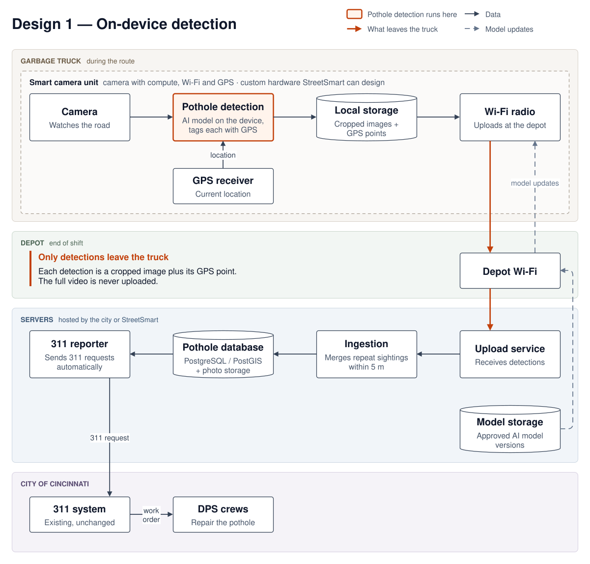
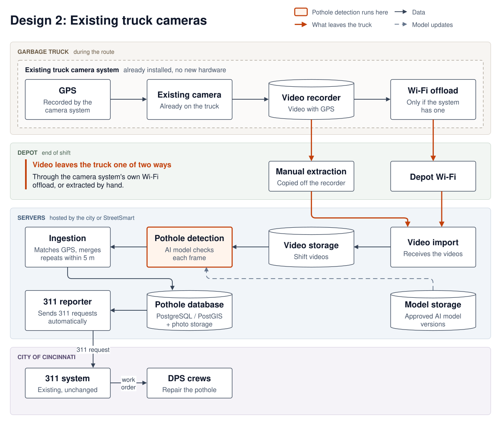
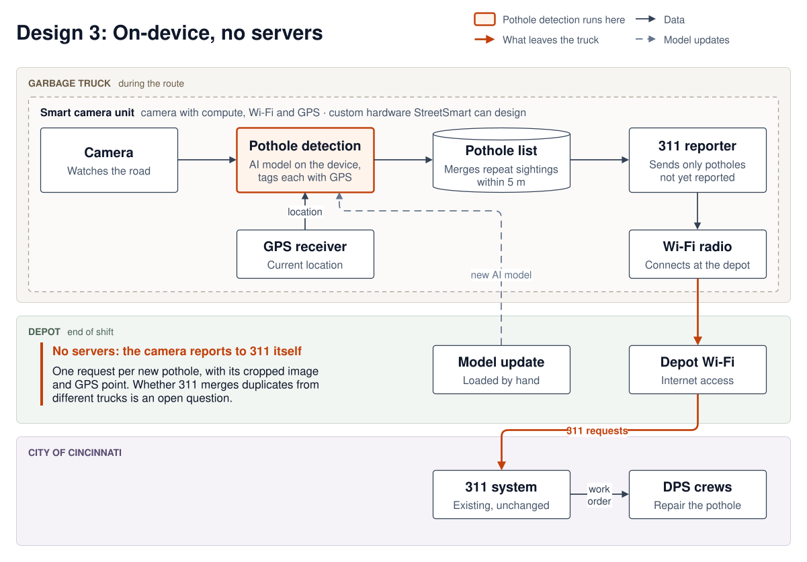

## Diagrams:

### Design 1 (On device processing. Camera with compute, Wi-Fi and GPS detects potholes during the run and tags each detection with its GPS coordinates. At the end of the shift, only the detections (GPS point and cropped image) are uploaded over depot Wi-Fi, not the full video. The servers then automate the 311 requests) (We can design the hardware for this)

**Figure 1: On-device detection.** Only GPS points and cropped images leave the truck.

### Design 2 (Uses the camera system already on the trucks, which records video and GPS. Videos are extracted manually, or through the system's own Wi-Fi offload if it has one. Then the servers run detection and automate the 311 requests)

**Figure 2: Existing truck cameras.** Video leaves the truck through the camera system's own Wi-Fi offload, or is extracted manually.

### Design 3 (Based on Design 1, but with no servers. The camera unit detects potholes, tags each detection with its GPS coordinates, and keeps its own list of potholes, merging repeat sightings within 5 m. At the end of the shift, it sends the 311 requests itself over depot Wi-Fi, one per new pothole, with the cropped image and GPS point. The 311 system is the only record of the potholes. New AI models are loaded onto the camera by hand) (We can design the hardware for this)

**Figure 3: On-device detection, no servers.** The camera sends the 311 requests itself; nothing else leaves the truck.

## Questions/Concerns:
1. What camera system do the garbage trucks already have (make and model)? Does it record GPS, and can the recorded videos with GPS data be extracted? Does it have Wi-fi offload at the depot?
	- Is there a forward-facing camera, and what resolution does it record at? Side/rear blind-spot cameras and low-resolution footage may not work well for pothole detection.
	- If the cameras don't record GPS, do the trucks have fleet GPS tracking (AVL/telematics) that can be synced to the video by timestamp?
	- Are the video recordings extracted by someone for administrative purposes (tracking neighborhoods, checking problems), and if so, how is it done?
	- If the existing system works, Design 2 is the most cost-effective solution: no cost for cameras, and no new hardware that can fail.
	- If we get a dedicated camera, it adds cost and needs to be wired into the vehicle's power. It turns on with the ignition, but has to stay on after the engine stops (delay timer or parking mode) long enough to finish the Wi-Fi upload.
2. Does the city or the 311 system have existing servers, and what computing power do they have (what processor, how much RAM, storage)?
	- If the city's own servers can handle the compute required by the machine learning models, it will remove any need to send data outside of the city's own system.
	- If StreetSmart hosts the servers, we can add a layer of security so that faces and licence plates are blurred before the data reaches StreetSmart (only in Design 1).
	- If StreetSmart hosts the servers, this removes any technical load from the city's employees, but adds more back-and-forth communication.
3. The machine learning models can make mistakes. Do we add a human reviewer before the automated 311 requests are sent, or do we send all requests and DPS handles the ML model's mistake?
	- City might add a group of community responders to verify the detected potholes before the request is sent to DPS.
	- If there are not a lot of mistakes, DPS might handle it themselves.
	- When we do the proof of concept runs, we can evaluate how many mistakes the models make and we can plan accordingly later.
	- Design 3 has no servers, so there is no place for a reviewer to check detections before the requests are sent.

## Some Answers from before:
1. The frequency of when the pothole detection runs completely depends on when the city wants it to run.
2. There is no reason to send the data to any external company or server. Either the city hosts it themselves, or StreetSmart hosts the servers. 
3. All these designs use the 311 system and sends the requests in the same way the website does. They do not modify the reporting system already in place.